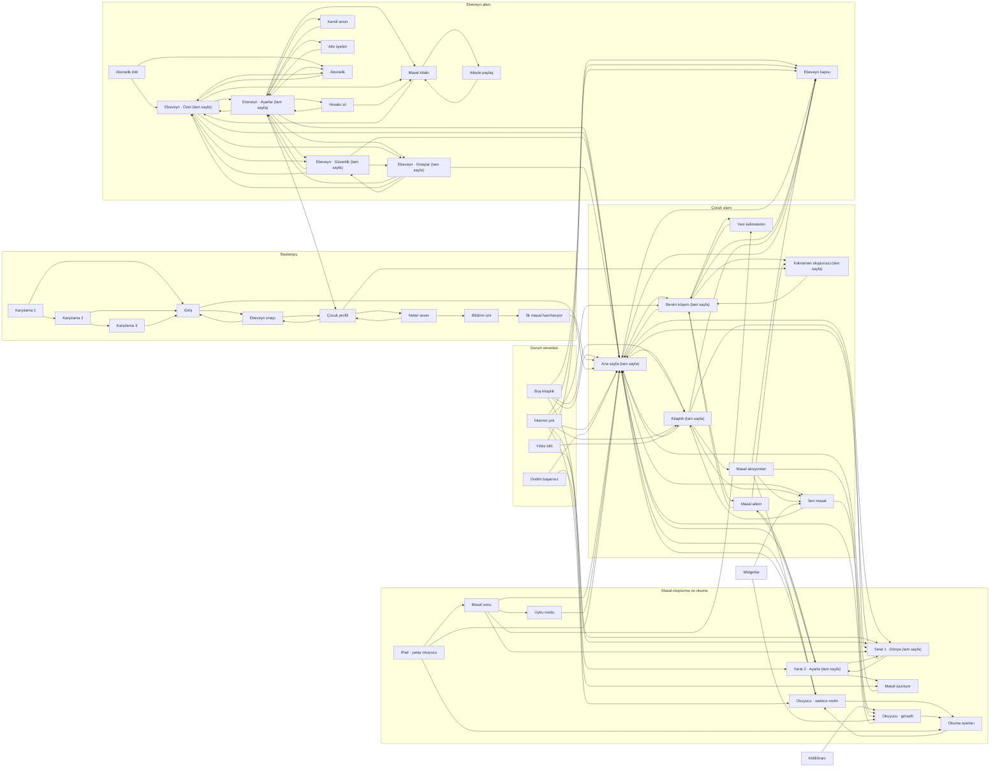

# Gezinme haritası

Prototipteki gerçek bağlantılardan üretildi (her `<a href>`). Uygulamadaki yönlendirici bu grafiği karşılamalı.

## Kökler

- `AppState.onboarding` → Karşılama → Giriş → Ebeveyn onayı → Çocuk profili (2 adım) → Bildirim izni → İlk masal → Okuyucu
- `AppState.kid` → çocuk kökü: özel alt bar (Ana sayfa · + Yarat · Kitaplık), her sekmede ayrı `NavigationStack(path:)`
- `AppState.parent` → ebeveyn kapısından sonra `fullScreenCover`; kendi `TabView`'i (Özet · Onaylar · Güvenlik · Ayarlar). Uygulama arka plana gidince kapanır.
- Yarat akışı, Okuyucu, Uyku modu: `fullScreenCover` (alt bar gizlenir).

## Grafik

## Bağlantı tablosu

| Nereden | Nereye |
|---|---|
| Karşılama 1 | Karşılama 2 |
| Karşılama 1 | Giriş |
| Karşılama 2 | Karşılama 3 |
| Karşılama 2 | Giriş |
| Karşılama 3 | Giriş |
| Giriş | Ebeveyn onayı |
| Giriş | Ana sayfa (tam sayfa) |
| Ebeveyn onayı | Giriş |
| Ebeveyn onayı | Çocuk profili |
| Çocuk profili | Ebeveyn onayı |
| Çocuk profili | Neleri sever |
| Çocuk profili | Kahraman oluşturucu (tam sayfa) |
| Neleri sever | Çocuk profili |
| Neleri sever | Bildirim izni |
| Bildirim izni | İlk masal hazırlanıyor |
| İlk masal hazırlanıyor | Ana sayfa (tam sayfa) |
| Ana sayfa (tam sayfa) | Benim köşem (tam sayfa) |
| Ana sayfa (tam sayfa) | Kitaplık (tam sayfa) |
| Ana sayfa (tam sayfa) | Seri masal |
| Ana sayfa (tam sayfa) | Yarat 1 · Dünya (tam sayfa) |
| Ana sayfa (tam sayfa) | Yarat 2 · Ayarla (tam sayfa) |
| Ana sayfa (tam sayfa) | Okuyucu · sadece metin |
| Ana sayfa (tam sayfa) | Ebeveyn kapısı |
| Benim köşem (tam sayfa) | Ana sayfa (tam sayfa) |
| Benim köşem (tam sayfa) | Kahraman oluşturucu (tam sayfa) |
| Benim köşem (tam sayfa) | Masal ailem |
| Benim köşem (tam sayfa) | Yeni kelimelerim |
| Benim köşem (tam sayfa) | Ebeveyn kapısı |
| Kahraman oluşturucu (tam sayfa) | Benim köşem (tam sayfa) |
| Masal ailem | Benim köşem (tam sayfa) |
| Masal ailem | Kahraman oluşturucu (tam sayfa) |
| Masal ailem | Yarat 2 · Ayarla (tam sayfa) |
| Yeni kelimelerim | Benim köşem (tam sayfa) |
| Kitaplık (tam sayfa) | Ana sayfa (tam sayfa) |
| Kitaplık (tam sayfa) | Masal aksiyonları |
| Kitaplık (tam sayfa) | Seri masal |
| Kitaplık (tam sayfa) | Yarat 1 · Dünya (tam sayfa) |
| Kitaplık (tam sayfa) | Ebeveyn kapısı |
| Masal aksiyonları | Seri masal |
| Masal aksiyonları | Okuyucu · görselli |
| Masal aksiyonları | Okuyucu · sadece metin |
| Masal aksiyonları | Ebeveyn kapısı |
| Seri masal | Kitaplık (tam sayfa) |
| Seri masal | Okuyucu · görselli |
| Yarat 1 · Dünya (tam sayfa) | Ana sayfa (tam sayfa) |
| Yarat 1 · Dünya (tam sayfa) | Yarat 2 · Ayarla (tam sayfa) |
| Yarat 2 · Ayarla (tam sayfa) | Masal ailem |
| Yarat 2 · Ayarla (tam sayfa) | Yarat 1 · Dünya (tam sayfa) |
| Yarat 2 · Ayarla (tam sayfa) | Masal yazılıyor |
| Masal yazılıyor | Ana sayfa (tam sayfa) |
| Okuyucu · görselli | Ana sayfa (tam sayfa) |
| Okuyucu · görselli | Okuma ayarları |
| Okuyucu · sadece metin | Ana sayfa (tam sayfa) |
| Okuyucu · sadece metin | Okuma ayarları |
| Okuma ayarları | Okuyucu · sadece metin |
| Masal sonu | Ana sayfa (tam sayfa) |
| Masal sonu | Yeni kelimelerim |
| Masal sonu | Yarat 1 · Dünya (tam sayfa) |
| Masal sonu | Uyku modu |
| Uyku modu | Ana sayfa (tam sayfa) |
| iPad · yatay okuyucu | Ana sayfa (tam sayfa) |
| iPad · yatay okuyucu | Okuma ayarları |
| iPad · yatay okuyucu | Masal sonu |
| Ebeveyn kapısı | Ana sayfa (tam sayfa) |
| Ebeveyn · Özet (tam sayfa) | Ana sayfa (tam sayfa) |
| Ebeveyn · Özet (tam sayfa) | Ebeveyn · Onaylar (tam sayfa) |
| Ebeveyn · Özet (tam sayfa) | Ebeveyn · Güvenlik (tam sayfa) |
| Ebeveyn · Özet (tam sayfa) | Ebeveyn · Ayarlar (tam sayfa) |
| Ebeveyn · Özet (tam sayfa) | Masal kitabı |
| Ebeveyn · Özet (tam sayfa) | Abonelik |
| Ebeveyn · Onaylar (tam sayfa) | Ana sayfa (tam sayfa) |
| Ebeveyn · Onaylar (tam sayfa) | Ebeveyn · Özet (tam sayfa) |
| Ebeveyn · Onaylar (tam sayfa) | Ebeveyn · Güvenlik (tam sayfa) |
| Ebeveyn · Onaylar (tam sayfa) | Ebeveyn · Ayarlar (tam sayfa) |
| Ebeveyn · Güvenlik (tam sayfa) | Ana sayfa (tam sayfa) |
| Ebeveyn · Güvenlik (tam sayfa) | Ebeveyn · Özet (tam sayfa) |
| Ebeveyn · Güvenlik (tam sayfa) | Ebeveyn · Onaylar (tam sayfa) |
| Ebeveyn · Güvenlik (tam sayfa) | Ebeveyn · Ayarlar (tam sayfa) |
| Ebeveyn · Ayarlar (tam sayfa) | Çocuk profili |
| Ebeveyn · Ayarlar (tam sayfa) | Ana sayfa (tam sayfa) |
| Ebeveyn · Ayarlar (tam sayfa) | Ebeveyn · Özet (tam sayfa) |
| Ebeveyn · Ayarlar (tam sayfa) | Ebeveyn · Onaylar (tam sayfa) |
| Ebeveyn · Ayarlar (tam sayfa) | Ebeveyn · Güvenlik (tam sayfa) |
| Ebeveyn · Ayarlar (tam sayfa) | Kendi sesin |
| Ebeveyn · Ayarlar (tam sayfa) | Aile üyeleri |
| Ebeveyn · Ayarlar (tam sayfa) | Masal kitabı |
| Ebeveyn · Ayarlar (tam sayfa) | Abonelik |
| Ebeveyn · Ayarlar (tam sayfa) | Hesabı sil |
| Kendi sesin | Ebeveyn · Ayarlar (tam sayfa) |
| Aile üyeleri | Ebeveyn · Ayarlar (tam sayfa) |
| Masal kitabı | Ebeveyn · Özet (tam sayfa) |
| Masal kitabı | Aileyle paylaş |
| Aileyle paylaş | Masal kitabı |
| Abonelik | Ebeveyn · Özet (tam sayfa) |
| Abonelik bitti | Ebeveyn · Özet (tam sayfa) |
| Abonelik bitti | Abonelik |
| Hesabı sil | Ebeveyn · Ayarlar (tam sayfa) |
| Hesabı sil | Masal kitabı |
| Widget'lar | Seri masal |
| Widget'lar | Okuyucu · görselli |
| Kilit ekranı ve Siri | Okuyucu · görselli |
| Boş kitaplık | Ana sayfa (tam sayfa) |
| Boş kitaplık | Kitaplık (tam sayfa) |
| Boş kitaplık | Yarat 1 · Dünya (tam sayfa) |
| Boş kitaplık | Ebeveyn kapısı |
| Üretim başarısız | Ana sayfa (tam sayfa) |
| Üretim başarısız | Masal yazılıyor |
| İnternet yok | Ana sayfa (tam sayfa) |
| İnternet yok | Benim köşem (tam sayfa) |
| İnternet yok | Kitaplık (tam sayfa) |
| İnternet yok | Yarat 1 · Dünya (tam sayfa) |
| İnternet yok | Okuyucu · sadece metin |
| İnternet yok | Ebeveyn kapısı |
| Yıldız bitti | Kitaplık (tam sayfa) |
| Yıldız bitti | Yarat 2 · Ayarla (tam sayfa) |
| Yıldız bitti | Ebeveyn kapısı |
