# Ekranlar (45 + 15 durum görüntüsü)

Her ekran için: ekran görüntüsü (@2x), rota, sunum biçimi, amaç, veri, etkileşimler ve ekrandaki metinler.
Metinler prototipten birebir alındı; uygulamada aynen kullan (Türkçe, "sen" dili, uzun tire yok).
Görsel değerler (renk, boşluk, köşe) için `reference/html/<Ekran>.dc.html` içindeki inline stiller kesin kaynaktır.

## İçindekiler


**Marka**

- [01 · Marka ve maskot](#01-marka)

**Başlangıç**

- [02 · Karşılama 1](#02-main)
- [03 · Karşılama 2](#03-onboarding2)
- [04 · Karşılama 3](#04-onboarding3)
- [05 · Giriş](#05-giris)
- [06 · Ebeveyn onayı](#06-ebeveynonayi)
- [07 · Çocuk profili](#07-profilolusturma)
- [08 · Neleri sever](#08-nelerisever)
- [09 · Bildirim izni](#09-bildirimizni)
- [10 · İlk masal hazırlanıyor](#10-ilkmasal)

**Çocuk alanı**

- [11 · Ana sayfa (tam sayfa)](#11-anasayfa)
- [12 · Benim köşem (tam sayfa)](#12-benimkosem)
- [13 · Kahraman oluşturucu (tam sayfa)](#13-kahramanolustur)
- [14 · Masal ailem](#14-masalailem)
- [15 · Yeni kelimelerim](#15-yenikelimeler)
- [16 · Kitaplık (tam sayfa)](#16-kutuphane)
- [17 · Masal aksiyonları](#17-masalaksiyon)
- [18 · Seri masal](#18-serimasal)

**Masal oluşturma ve okuma**

- [19 · Yarat 1 · Dünya (tam sayfa)](#19-sihirbaznerede)
- [20 · Yarat 2 · Ayarla (tam sayfa)](#20-sihirbaznasil)
- [21 · Masal yazılıyor](#21-uretim)
- [22 · Okuyucu · görselli](#22-okuyucugorselli)
- [23 · Okuyucu · sadece metin](#23-okuyucu)
- [24 · Okuma ayarları](#24-okumaayarlari)
- [25 · Masal sonu](#25-masalsonu)
- [26 · Uyku modu](#26-uykumodu)
- [27 · iPad · yatay okuyucu](#27-ipadokuyucu)

**Ebeveyn alanı**

- [28 · Ebeveyn kapısı](#28-ebeveynkapisi)
- [29 · Ebeveyn · Özet (tam sayfa)](#29-ebeveynpaneli)
- [30 · Ebeveyn · Onaylar (tam sayfa)](#30-onaybekleyenler)
- [31 · Ebeveyn · Güvenlik (tam sayfa)](#31-icerikguvenligi)
- [32 · Ebeveyn · Ayarlar (tam sayfa)](#32-ayarlar)
- [33 · Kendi sesin](#33-seskaydi)
- [34 · Aile üyeleri](#34-aileuyeleri)
- [35 · Masal kitabı](#35-kitapsiparisi)
- [36 · Aileyle paylaş](#36-paylas)
- [37 · Abonelik](#37-paywall)
- [38 · Abonelik bitti](#38-abonelikbitti)
- [39 · Hesabı sil](#39-hesapsil)

**iOS yüzeyleri**

- [40 · Widget'lar](#40-widgetlar)
- [41 · Kilit ekranı ve Siri](#41-kilitekrani)

**Durum ekranları**

- [42 · Boş kitaplık](#42-boskitaplik)
- [43 · Üretim başarısız](#43-uretimhata)
- [44 · İnternet yok](#44-internetyok)
- [45 · Yıldız bitti](#45-yildizbitti)


---

## 01 · Marka ve maskot
<a id="01-marka"></a>

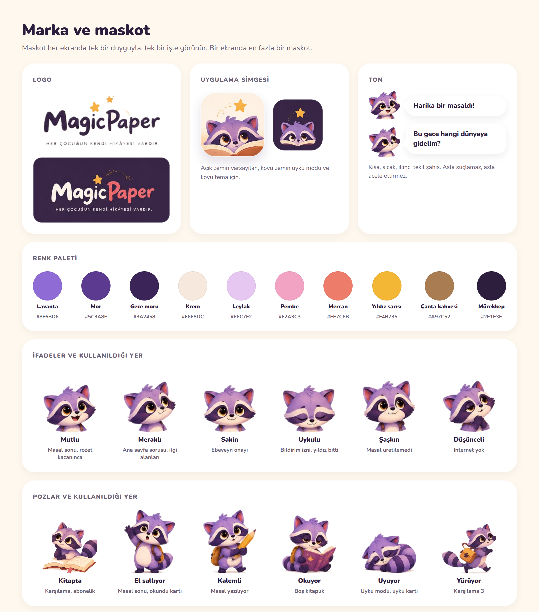

| | |
|---|---|
| Alan | Marka |
| Rota | `yok` |
| Sunum | yok |
| Boyut | 1180 × 1340 pt (prototip artboard) |
| Kaynak | `reference/html/Marka.dc.html` |

**Amaç.** Marka ve maskot rehberi: logo, uygulama simgesi, ton, palet, ifadeler ve pozların kullanıldığı yer. Uygulamada ekran değil, referans.

**Veri.** yok

**Uygulama notları.** Maskot kuralları bu kartın alt yarısında. docs/BRAND_AND_MASCOT.md ile aynı.

<details><summary>Ekrandaki metinler</summary>

```text
Marka ve maskot
Maskot her ekranda tek bir duyguyla, tek bir işle görünür. Bir ekranda en fazla bir maskot.
LOGO
UYGULAMA SİMGESİ
Açık zemin varsayılan, koyu zemin uyku modu ve koyu tema için.
TON
Harika bir masaldı!
Bu gece hangi dünyaya gidelim?
Kısa, sıcak, ikinci tekil şahıs. Asla suçlamaz, asla acele ettirmez.
RENK PALETİ
Lavanta
#8F6BD6
Mor
#5C3A8F
Gece moru
#3A2458
Krem
#F6E8DC
Leylak
#E6C7F2
Pembe
#F2A3C3
Mercan
#EE7C6B
Yıldız sarısı
#F4B735
Çanta kahvesi
#A97C52
Mürekkep
#2E1E3E
İFADELER VE KULLANILDIĞI YER
Mutlu
Masal sonu, rozet kazanınca
Meraklı
Ana sayfa sorusu, ilgi alanları
Sakin
Ebeveyn onayı
Uykulu
Bildirim izni, yıldız bitti
Şaşkın
Masal üretilemedi
Düşünceli
İnternet yok
POZLAR VE KULLANILDIĞI YER
Kitapta
Karşılama, abonelik
El sallıyor
Masal sonu, okundu kartı
Kalemli
Masal yazılıyor
Okuyor
Boş kitaplık
Uyuyor
Uyku modu, uyku kartı
Yürüyor
Karşılama 3
```
</details>

---

## 02 · Karşılama 1
<a id="02-main"></a>

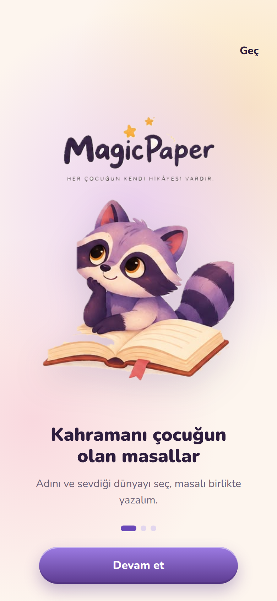

| | |
|---|---|
| Alan | Başlangıç |
| Rota | `welcome(page: 0)` |
| Sunum | root (onboarding stack) |
| Boyut | 390 × 844 pt (prototip artboard) |
| Kaynak | `reference/html/Main.dc.html` |

**Amaç.** Karşılama 1: logo, kitaptaki rakun, değer önerisi.

**Veri.** Yok.

**Uygulama notları.** Arka plan krem + leylak/pembe/sarı radyal ışıklar. Geç → Giriş.

**Gezinme (dokununca nereye gider).**
- "Geç" → 05 · Giriş
- "Devam et" → 03 · Karşılama 2

<details><summary>Ekrandaki metinler</summary>

```text
Geç
Kahramanı çocuğun olan masallar
Adını ve sevdiği dünyayı seç, masalı birlikte yazalım.
Devam et
```
</details>

---

## 03 · Karşılama 2
<a id="03-onboarding2"></a>

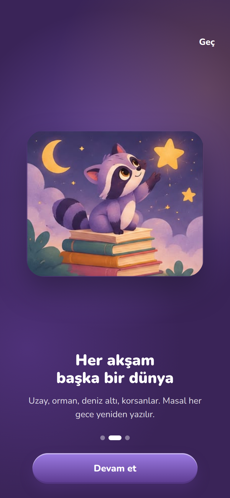

| | |
|---|---|
| Alan | Başlangıç |
| Rota | `welcome(page: 1)` |
| Sunum | page (TabView .page) |
| Boyut | 390 × 844 pt (prototip artboard) |
| Kaynak | `reference/html/Onboarding2.dc.html` |

**Amaç.** Karşılama 2: her akşam başka dünya. Gece sahnesi, koyu mor zemin.

**Veri.** Yok.

**Uygulama notları.** Tek ekranda 3 sayfa: TabView(.page) önerilir; noktalar özel bileşen.

**Gezinme (dokununca nereye gider).**
- "Geç" → 05 · Giriş
- "Devam et" → 04 · Karşılama 3

<details><summary>Ekrandaki metinler</summary>

```text
Geç
Her akşam başka bir dünya
Uzay, orman, deniz altı, korsanlar. Masal her gece yeniden yazılır.
Devam et
```
</details>

---

## 04 · Karşılama 3
<a id="04-onboarding3"></a>

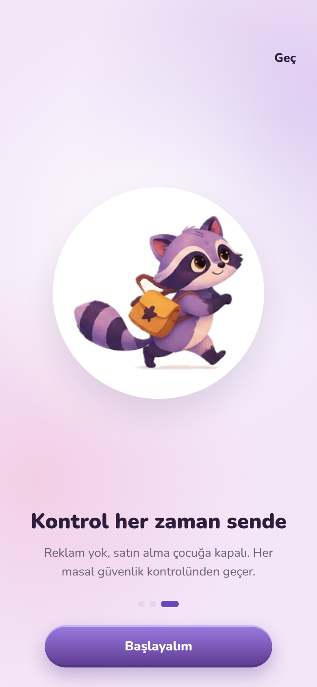

| | |
|---|---|
| Alan | Başlangıç |
| Rota | `welcome(page: 2)` |
| Sunum | page |
| Boyut | 390 × 844 pt (prototip artboard) |
| Kaynak | `reference/html/Onboarding3.dc.html` |

**Amaç.** Karşılama 3: güven mesajı (reklam yok, satın alma çocuğa kapalı).

**Veri.** Yok.

**Uygulama notları.** Yürüyen rakun beyaz daire içinde. Başlayalım → Giriş.

**Gezinme (dokununca nereye gider).**
- "Geç" → 05 · Giriş
- "Başlayalım" → 05 · Giriş

<details><summary>Ekrandaki metinler</summary>

```text
Geç
Kontrol her zaman sende
Reklam yok, satın alma çocuğa kapalı. Her masal güvenlik kontrolünden geçer.
Başlayalım
```
</details>

---

## 05 · Giriş
<a id="05-giris"></a>

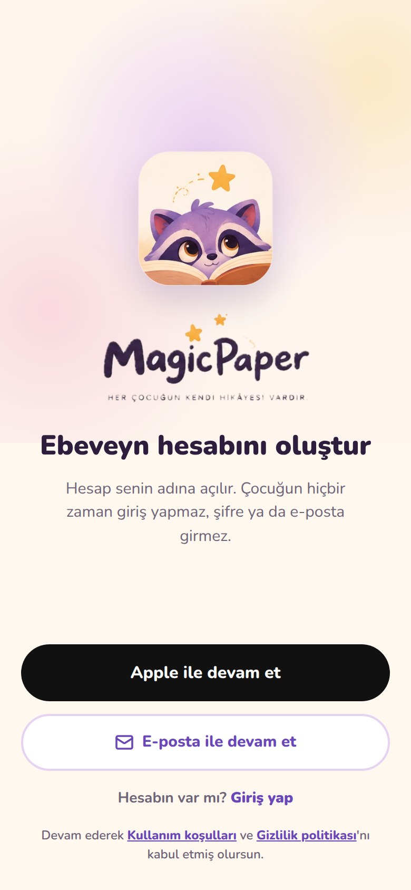

| | |
|---|---|
| Alan | Başlangıç |
| Rota | `signIn` |
| Sunum | push |
| Boyut | 390 × 844 pt (prototip artboard) |
| Kaynak | `reference/html/Giris.dc.html` |

**Amaç.** Ebeveyn hesabı: Apple ile giriş, e-posta ile giriş.

**Veri.** Sign in with Apple, e-posta auth.

**Uygulama notları.** Apple butonu için ASAuthorizationAppleIDButton (siyah) kullan; logo zorunlu. Çocuk asla giriş yapmaz.

**Gezinme (dokununca nereye gider).**
- "Apple ile devam et" → 06 · Ebeveyn onayı
- "E-posta ile devam et" → 06 · Ebeveyn onayı
- "Giriş yap" → 11 · Ana sayfa (tam sayfa)

<details><summary>Ekrandaki metinler</summary>

```text
Ebeveyn hesabını oluştur
Hesap senin adına açılır. Çocuğun hiçbir zaman giriş yapmaz, şifre ya da e-posta girmez.
Apple ile devam et
E-posta ile devam et
Hesabın var mı? Giriş yap
Devam ederek Kullanım koşulları ve Gizlilik politikası'nı kabul etmiş olursun.
```
</details>

---

## 06 · Ebeveyn onayı
<a id="06-ebeveynonayi"></a>

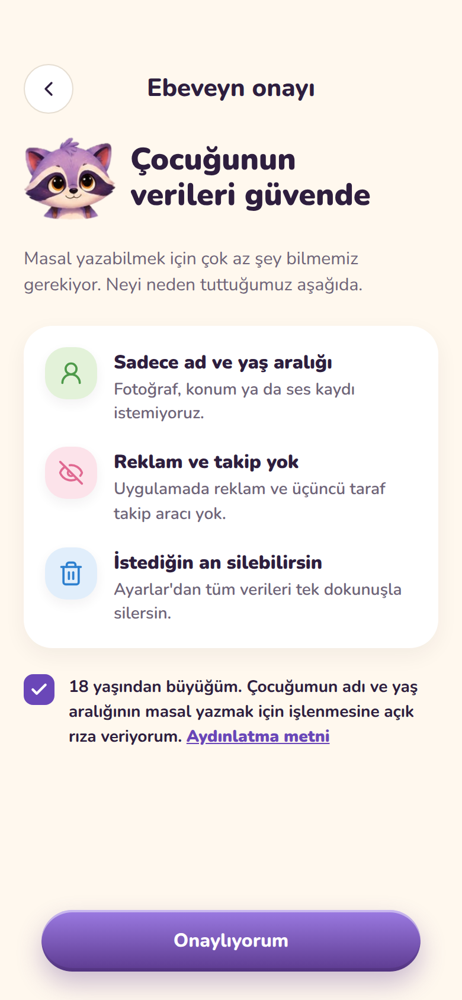

| | |
|---|---|
| Alan | Başlangıç |
| Rota | `parentalConsent` |
| Sunum | push |
| Boyut | 390 × 844 pt (prototip artboard) |
| Kaynak | `reference/html/EbeveynOnayi.dc.html` |

**Amaç.** KVKK açık rıza: ne tuttuğumuz, onay kutusu.

**Veri.** consentAcceptedAt kaydı (backend).

**Uygulama notları.** Kutu işaretli değilse buton pasif (state-EbeveynOnayi-onaysiz). Aydınlatma metni linki.

**Gezinme (dokununca nereye gider).**
- "Geri" → 05 · Giriş
- "Onaylıyorum" → 07 · Çocuk profili

**Ekran içi kontroller.** `18 yaşından büyüğüm. Çocuğumun adı ve yaş aralığının masal yazmak için işlenmesine açık rıza veriyorum. Aydınlatma metni`

**Durum görüntüleri.** [Kutu işaretsiz, buton pasif](../screens/state-EbeveynOnayi-onaysiz.png)

<details><summary>Ekrandaki metinler</summary>

```text
Ebeveyn onayı
Çocuğunun verileri güvende
Masal yazabilmek için çok az şey bilmemiz gerekiyor. Neyi neden tuttuğumuz aşağıda.
Sadece ad ve yaş aralığı
Fotoğraf, konum ya da ses kaydı istemiyoruz.
Reklam ve takip yok
Uygulamada reklam ve üçüncü taraf takip aracı yok.
İstediğin an silebilirsin
Ayarlar'dan tüm verileri tek dokunuşla silersin.
18 yaşından büyüğüm. Çocuğumun adı ve yaş aralığının masal yazmak için işlenmesine açık rıza veriyorum. Aydınlatma metni
Onaylıyorum
```
</details>

---

## 07 · Çocuk profili
<a id="07-profilolusturma"></a>

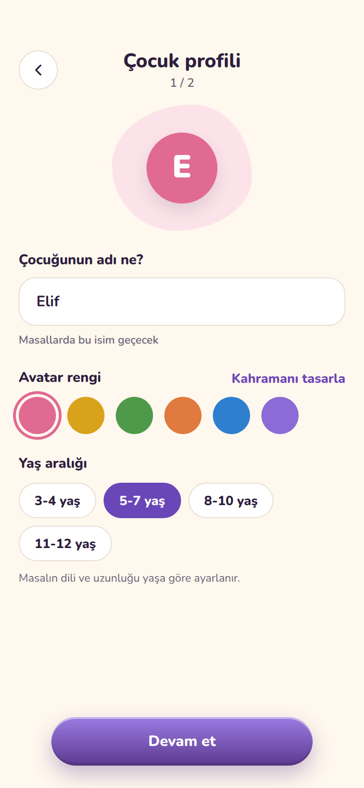

| | |
|---|---|
| Alan | Başlangıç |
| Rota | `createChildProfile(step: 1)` |
| Sunum | push |
| Boyut | 390 × 844 pt (prototip artboard) |
| Kaynak | `reference/html/ProfilOlusturma.dc.html` |

**Amaç.** Çocuk profili 1/2: ad, avatar rengi, yaş aralığı; 'Kahramanı tasarla' linki.

**Veri.** ChildProfile(name, ageBand, avatar).

**Uygulama notları.** Ad: 1–20 karakter, harf/boşluk/tire. Avatar baş harfi canlı güncellenir.

**Gezinme (dokununca nereye gider).**
- "Geri" → 06 · Ebeveyn onayı
- "Kahramanı tasarla" → 13 · Kahraman oluşturucu (tam sayfa)
- "Devam et" → 08 · Neleri sever

**Ekran içi kontroller.** `Pembe` · `Sarı` · `Yeşil` · `Turuncu` · `Mavi` · `Mor` · `3-4 yaş` · `5-7 yaş` · `8-10 yaş` · `11-12 yaş`

**Alanlar.** Örn. Elif (placeholder: "Örn. Elif")

<details><summary>Ekrandaki metinler</summary>

```text
Çocuk profili
1 / 2
Çocuğunun adı ne?
Masallarda bu isim geçecek
Avatar rengi
Kahramanı tasarla
Yaş aralığı
3-4 yaş
5-7 yaş
8-10 yaş
11-12 yaş
Masalın dili ve uzunluğu yaşa göre ayarlanır.
Devam et
```
</details>

---

## 08 · Neleri sever
<a id="08-nelerisever"></a>

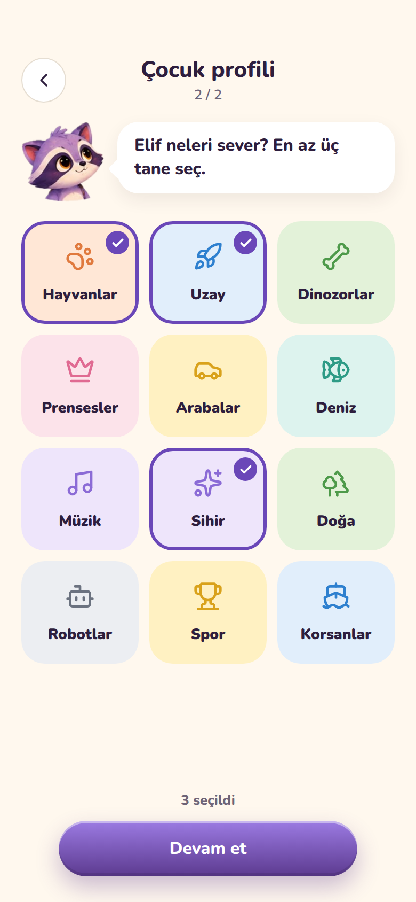

| | |
|---|---|
| Alan | Başlangıç |
| Rota | `createChildProfile(step: 2)` |
| Sunum | push |
| Boyut | 390 × 844 pt (prototip artboard) |
| Kaynak | `reference/html/NeleriSever.dc.html` |

**Amaç.** Çocuk profili 2/2: ilgi alanları (en az 3).

**Veri.** interests: [String].

**Uygulama notları.** Meraklı rakun + balon. 12 ilgi kartı, seçili = mor çerçeve + tik. Sayaç 'X seçildi'.

**Gezinme (dokununca nereye gider).**
- "Geri" → 07 · Çocuk profili
- "Devam et" → 09 · Bildirim izni

**Ekran içi kontroller.** `Hayvanlar` · `Uzay` · `Dinozorlar` · `Prensesler` · `Arabalar` · `Deniz` · `Müzik` · `Sihir` · `Doğa` · `Robotlar` · `Spor` · `Korsanlar`

<details><summary>Ekrandaki metinler</summary>

```text
Çocuk profili
2 / 2
Elif neleri sever? En az üç tane seç.
Hayvanlar
Uzay
Dinozorlar
Prensesler
Arabalar
Deniz
Müzik
Sihir
Doğa
Robotlar
Spor
Korsanlar
3 seçildi
Devam et
```
</details>

---

## 09 · Bildirim izni
<a id="09-bildirimizni"></a>

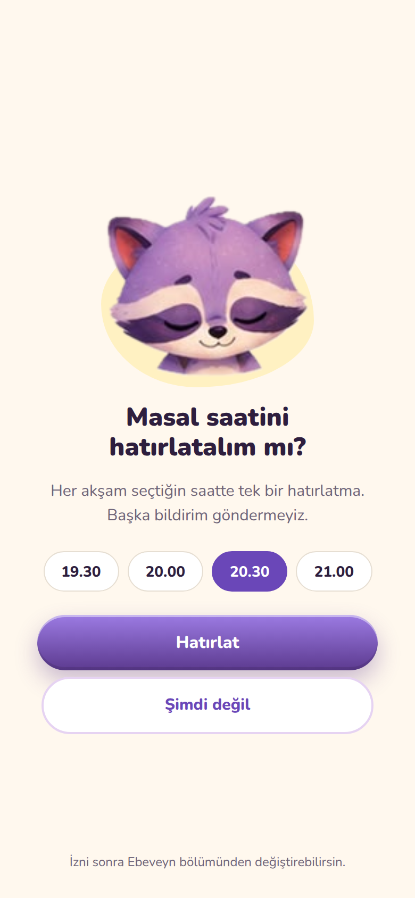

| | |
|---|---|
| Alan | Başlangıç |
| Rota | `notificationPrePrompt` |
| Sunum | push |
| Boyut | 390 × 844 pt (prototip artboard) |
| Kaynak | `reference/html/BildirimIzni.dc.html` |

**Amaç.** Bildirim izni ön ekranı: masal saati seçimi, sonra sistem izni.

**Veri.** reminderTime.

**Uygulama notları.** 'Şimdi değil' eşit ağırlıkta (outline). Sistem izni yalnızca 'Hatırlat'a basınca istenir.

**Gezinme (dokununca nereye gider).**
- "Hatırlat" → 10 · İlk masal hazırlanıyor
- "Şimdi değil" → 10 · İlk masal hazırlanıyor

**Ekran içi kontroller.** `19.30` · `20.00` · `20.30` · `21.00`

<details><summary>Ekrandaki metinler</summary>

```text
Masal saatini hatırlatalım mı?
Her akşam seçtiğin saatte tek bir hatırlatma. Başka bildirim göndermeyiz.
19.30
20.00
20.30
21.00
Hatırlat
Şimdi değil
İzni sonra Ebeveyn bölümünden değiştirebilirsin.
```
</details>

---

## 10 · İlk masal hazırlanıyor
<a id="10-ilkmasal"></a>

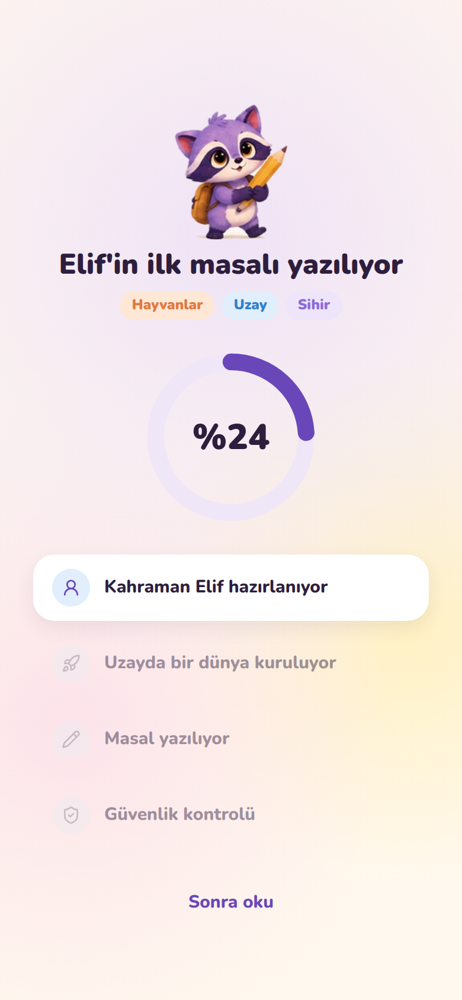

| | |
|---|---|
| Alan | Başlangıç |
| Rota | `firstStoryGenerating` |
| Sunum | fullScreen |
| Boyut | 390 × 844 pt (prototip artboard) |
| Kaynak | `reference/html/IlkMasal.dc.html` |

**Amaç.** İlk masal hazırlanıyor: kalemli rakun, ilerleme halkası, 4 aşama.

**Veri.** Motor iş durumu (SSE).

**Uygulama notları.** Aşamalar backend iş durumuna bağlanır: queued, writing, checking. Bitince 'Masalı oku'.

**Gezinme (dokununca nereye gider).**
- "Sonra oku" → 11 · Ana sayfa (tam sayfa)

<details><summary>Ekrandaki metinler</summary>

```text
Elif'in ilk masalı yazılıyor
Hayvanlar
Uzay
Sihir
%28
Kahraman Elif hazırlanıyor
Uzayda bir dünya kuruluyor
Masal yazılıyor
Güvenlik kontrolü
Sonra oku
```
</details>

---

## 11 · Ana sayfa (tam sayfa)
<a id="11-anasayfa"></a>

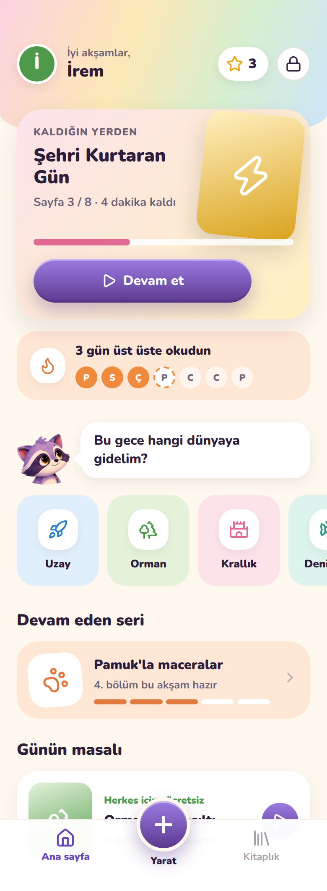

| | |
|---|---|
| Alan | Çocuk alanı |
| Rota | `kid(.home)` |
| Sunum | tab root |
| Boyut | 390 × 1060 pt (prototip artboard) |
| Kaynak | `reference/html/AnaSayfa.dc.html` |

**Amaç.** Ana sayfa: kid header, 'Bu akşamın masalı' kartı (4 durum), seri şeridi, dünya şeridi, devam eden seri, günün masalı.

**Veri.** Profil, yıldız, son okuma, seri, günün masalı.

**Uygulama notları.** Kart durumu kurala göre: yarım masal varsa → Devam; bugün okunmadıysa → bu akşamın masalı; okunduysa → Harika gidiyorsun; saat ≥ uyku saati → Uyku. Dünya şeridi Yarat 2'ye (dünya seçili) atlar.

**Gezinme (dokununca nereye gider).**
- "İ İyi akşamlar, İrem" → 12 · Benim köşem (tam sayfa)
- "3" → 12 · Benim köşem (tam sayfa)
- "Ebeveyn bölümü" → 28 · Ebeveyn kapısı
- "Devam et" → 23 · Okuyucu · sadece metin
- "3 gün üst üste okudun P S Ç P C C P" → 12 · Benim köşem (tam sayfa)
- "Uzay" → 20 · Yarat 2 · Ayarla (tam sayfa)
- "Orman" → 20 · Yarat 2 · Ayarla (tam sayfa)
- "Krallık" → 20 · Yarat 2 · Ayarla (tam sayfa)
- "Deniz altı" → 20 · Yarat 2 · Ayarla (tam sayfa)
- "Dinozorlar" → 20 · Yarat 2 · Ayarla (tam sayfa)
- "Kahraman" → 20 · Yarat 2 · Ayarla (tam sayfa)
- "Pamuk'la maceralar 4. bölüm bu akşam hazır" → 18 · Seri masal
- "Herkes için · ücretsiz Ormandaki Fısıltı 5 dakika · sesli okunur" → 23 · Okuyucu · sadece metin
- "Ana sayfa" → 11 · Ana sayfa (tam sayfa)
- "Yarat" → 19 · Yarat 1 · Dünya (tam sayfa)
- "Kitaplık" → 16 · Kitaplık (tam sayfa)

<details><summary>Ekrandaki metinler</summary>

```text
İyi akşamlar,
İrem
KALDIĞIN YERDEN
Şehri Kurtaran Gün
Sayfa 3 / 8 · 4 dakika kaldı
Devam et
3 gün üst üste okudun
Bu gece hangi dünyaya gidelim?
Uzay
Orman
Krallık
Deniz altı
Dinozorlar
Kahraman
Devam eden seri
Pamuk'la maceralar
4. bölüm bu akşam hazır
Günün masalı
Herkes için · ücretsiz
Ormandaki Fısıltı
5 dakika · sesli okunur
Ana sayfa
Yarat
Kitaplık
```
</details>

---

## 12 · Benim köşem (tam sayfa)
<a id="12-benimkosem"></a>

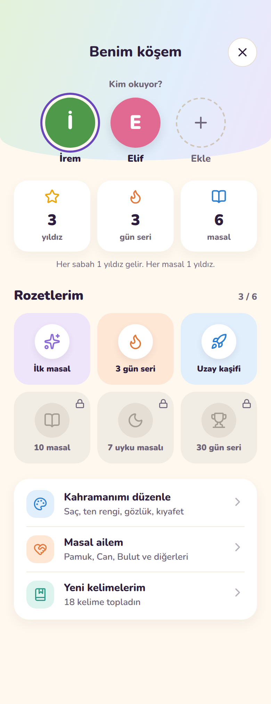

| | |
|---|---|
| Alan | Çocuk alanı |
| Rota | `kidCorner` |
| Sunum | fullScreen (avatar) |
| Boyut | 390 × 1010 pt (prototip artboard) |
| Kaynak | `reference/html/BenimKosem.dc.html` |

**Amaç.** Benim köşem: profil seçimi, yıldız/seri/masal sayıları, rozetler, kahraman düzenleme, masal ailem, yeni kelimeler.

**Veri.** Profiller, istatistik, rozetler.

**Uygulama notları.** 'Ekle' ebeveyn kapısına gider. Rozetler 3 sütun.

**Gezinme (dokununca nereye gider).**
- "Kapat" → 11 · Ana sayfa (tam sayfa)
- "Ekle" → 28 · Ebeveyn kapısı
- "Kahramanımı düzenle Saç, ten rengi, gözlük, kıyafet" → 13 · Kahraman oluşturucu (tam sayfa)
- "Masal ailem Pamuk, Can, Bulut ve diğerleri" → 14 · Masal ailem
- "Yeni kelimelerim 18 kelime topladın" → 15 · Yeni kelimelerim

**Ekran içi kontroller.** `İ İrem` · `E Elif`

<details><summary>Ekrandaki metinler</summary>

```text
Benim köşem
Kim okuyor?
İrem
Elif
Ekle
yıldız
gün seri
masal
Her sabah 1 yıldız gelir. Her masal 1 yıldız.
Rozetlerim
3 / 6
İlk masal
3 gün seri
Uzay kaşifi
10 masal
7 uyku masalı
30 gün seri
Kahramanımı düzenle
Saç, ten rengi, gözlük, kıyafet
Masal ailem
Pamuk, Can, Bulut ve diğerleri
Yeni kelimelerim
18 kelime topladın
```
</details>

---

## 13 · Kahraman oluşturucu (tam sayfa)
<a id="13-kahramanolustur"></a>

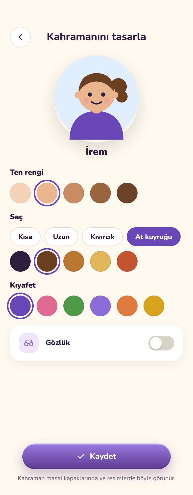

| | |
|---|---|
| Alan | Çocuk alanı |
| Rota | `heroEditor` |
| Sunum | push |
| Boyut | 390 × 1000 pt (prototip artboard) |
| Kaynak | `reference/html/KahramanOlustur.dc.html` |

**Amaç.** Kahraman oluşturucu: ten, saç modeli ve rengi, kıyafet, gözlük; canlı avatar.

**Veri.** HeroAvatar.

**Uygulama notları.** HeroAvatarView (Canvas) prototip SVG ile aynı geometri. Foto asla istenmez.

**Gezinme (dokununca nereye gider).**
- "Geri" → 12 · Benim köşem (tam sayfa)
- "Kaydet" → 12 · Benim köşem (tam sayfa)

**Ekran içi kontroller.** `Renk 1` · `Renk 2` · `Renk 3` · `Renk 4` · `Renk 5` · `Kısa` · `Uzun` · `Kıvırcık` · `At kuyruğu` · `Renk 6`

<details><summary>Ekrandaki metinler</summary>

```text
Kahramanını tasarla
İrem
Ten rengi
Saç
Kısa
Uzun
Kıvırcık
At kuyruğu
Kıyafet
Gözlük
Kaydet
Kahraman masal kapaklarında ve resimlerde böyle görünür.
```
</details>

---

## 14 · Masal ailem
<a id="14-masalailem"></a>

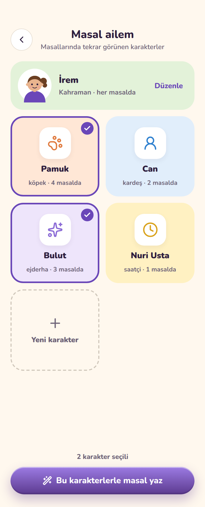

| | |
|---|---|
| Alan | Çocuk alanı |
| Rota | `storyFamily` |
| Sunum | push |
| Boyut | 390 × 960 pt (prototip artboard) |
| Kaynak | `reference/html/MasalAilem.dc.html` |

**Amaç.** Masal ailem: tekrar kullanılan karakterler, seç ve onlarla yaz.

**Veri.** Characters [{name, kind, traits}].

**Uygulama notları.** Kahraman kartı tam genişlik; diğerleri 2 sütun; 'Yeni karakter' kesikli kart.

**Gezinme (dokununca nereye gider).**
- "Geri" → 12 · Benim köşem (tam sayfa)
- "Düzenle" → 13 · Kahraman oluşturucu (tam sayfa)
- "Yeni karakter" → 13 · Kahraman oluşturucu (tam sayfa)
- "Bu karakterlerle masal yaz" → 20 · Yarat 2 · Ayarla (tam sayfa)

**Ekran içi kontroller.** `Pamuk köpek · 4 masalda` · `Can kardeş · 2 masalda` · `Bulut ejderha · 3 masalda` · `Nuri Usta saatçi · 1 masalda`

<details><summary>Ekrandaki metinler</summary>

```text
Masal ailem
Masallarında tekrar görünen karakterler
İrem
Kahraman · her masalda
Düzenle
Pamuk
köpek · 4 masalda
Can
kardeş · 2 masalda
Bulut
ejderha · 3 masalda
Nuri Usta
saatçi · 1 masalda
Yeni karakter
2 karakter seçili
Bu karakterlerle masal yaz
```
</details>

---

## 15 · Yeni kelimelerim
<a id="15-yenikelimeler"></a>

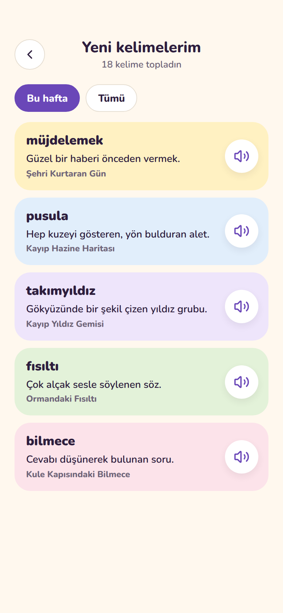

| | |
|---|---|
| Alan | Çocuk alanı |
| Rota | `newWords` |
| Sunum | push |
| Boyut | 390 × 844 pt (prototip artboard) |
| Kaynak | `reference/html/YeniKelimeler.dc.html` |

**Amaç.** Yeni kelimelerim: masallarda geçen kelimeler, anlam, dinle butonu.

**Veri.** wordList (StoryResponse) toplanmış.

**Uygulama notları.** Dinle: AVSpeechSynthesizer tr-TR. Basılıyken buton mor dolu.

**Gezinme (dokununca nereye gider).**
- "Geri" → 12 · Benim köşem (tam sayfa)

**Ekran içi kontroller.** `Bu hafta` · `Tümü` · `müjdelemek kelimesini dinle` · `pusula kelimesini dinle` · `takımyıldız kelimesini dinle` · `fısıltı kelimesini dinle` · `bilmece kelimesini dinle`

<details><summary>Ekrandaki metinler</summary>

```text
Yeni kelimelerim
18 kelime topladın
Bu hafta
Tümü
müjdelemek
Güzel bir haberi önceden vermek.
Şehri Kurtaran Gün
pusula
Hep kuzeyi gösteren, yön bulduran alet.
Kayıp Hazine Haritası
takımyıldız
Gökyüzünde bir şekil çizen yıldız grubu.
Kayıp Yıldız Gemisi
fısıltı
Çok alçak sesle söylenen söz.
Ormandaki Fısıltı
bilmece
Cevabı düşünerek bulunan soru.
Kule Kapısındaki Bilmece
```
</details>

---

## 16 · Kitaplık (tam sayfa)
<a id="16-kutuphane"></a>

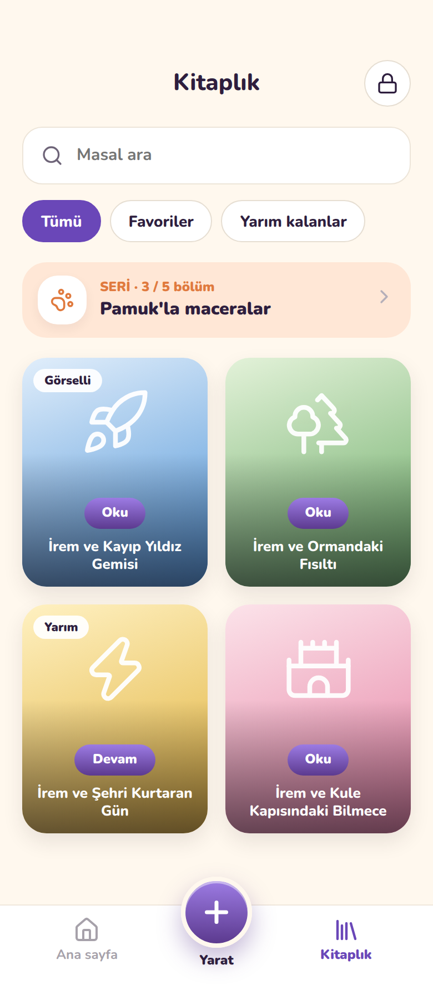

| | |
|---|---|
| Alan | Çocuk alanı |
| Rota | `kid(.library)` |
| Sunum | tab root |
| Boyut | 390 × 900 pt (prototip artboard) |
| Kaynak | `reference/html/Kutuphane.dc.html` |

**Amaç.** Kitaplık: arama, filtre çipleri, seri bandı, 2 sütun kapak ızgarası.

**Veri.** Masallar (yerel SwiftData + sunucu).

**Uygulama notları.** Kapakta rozet: Görselli / Yarım / İndirildi. Uzun bas → Masal aksiyonları sheet.

**Gezinme (dokununca nereye gider).**
- "Ebeveyn bölümü" → 28 · Ebeveyn kapısı
- "SERİ · 3 / 5 bölüm Pamuk'la maceralar" → 18 · Seri masal
- "Görselli Oku İrem ve Kayıp Yıldız Gemisi" → 17 · Masal aksiyonları
- "Oku İrem ve Ormandaki Fısıltı" → 17 · Masal aksiyonları
- "Yarım Devam İrem ve Şehri Kurtaran Gün" → 17 · Masal aksiyonları
- "Oku İrem ve Kule Kapısındaki Bilmece" → 17 · Masal aksiyonları
- "Ana sayfa" → 11 · Ana sayfa (tam sayfa)
- "Yarat" → 19 · Yarat 1 · Dünya (tam sayfa)
- "Kitaplık" → 16 · Kitaplık (tam sayfa)

**Ekran içi kontroller.** `Tümü` · `Favoriler` · `Yarım kalanlar`

**Alanlar.** Masal ara (placeholder: "Masal ara")

<details><summary>Ekrandaki metinler</summary>

```text
Kitaplık
Tümü
Favoriler
Yarım kalanlar
SERİ · 3 / 5 bölüm
Pamuk'la maceralar
Görselli
Oku
İrem ve Kayıp Yıldız Gemisi
İrem ve Ormandaki Fısıltı
Yarım
Devam
İrem ve Şehri Kurtaran Gün
İrem ve Kule Kapısındaki Bilmece
Ana sayfa
Yarat
```
</details>

---

## 17 · Masal aksiyonları
<a id="17-masalaksiyon"></a>

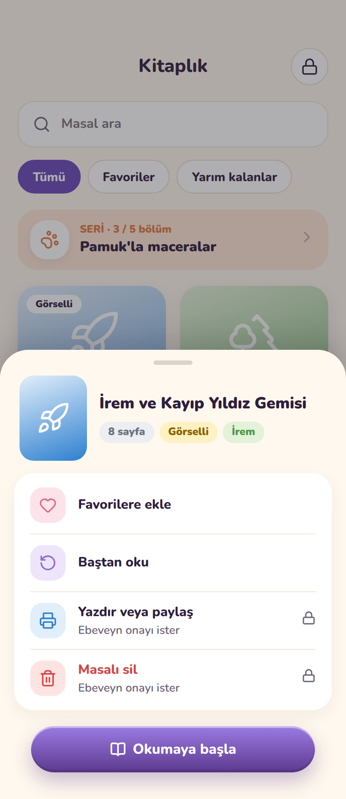

| | |
|---|---|
| Alan | Çocuk alanı |
| Rota | `storyActions(id)` |
| Sunum | sheet (.medium) |
| Boyut | 390 × 900 pt (prototip artboard) |
| Kaynak | `reference/html/MasalAksiyon.dc.html` |

**Amaç.** Masal aksiyonları: favori, baştan oku, yazdır/paylaş (kilitli), sil (kilitli).

**Veri.** Story.

**Uygulama notları.** Kilitli satırlar ebeveyn kapısından geçer. Birincil: Okumaya başla.

**Gezinme (dokununca nereye gider).**
- "Ebeveyn bölümü" → 28 · Ebeveyn kapısı
- "SERİ · 3 / 5 bölüm Pamuk'la maceralar" → 18 · Seri masal
- "Görselli Oku İrem ve Kayıp Yıldız Gemisi" → 17 · Masal aksiyonları
- "Oku İrem ve Ormandaki Fısıltı" → 17 · Masal aksiyonları
- "Yarım Devam İrem ve Şehri Kurtaran Gün" → 17 · Masal aksiyonları
- "Oku İrem ve Kule Kapısındaki Bilmece" → 17 · Masal aksiyonları
- "Baştan oku" → 23 · Okuyucu · sadece metin
- "Yazdır veya paylaş Ebeveyn onayı ister" → 28 · Ebeveyn kapısı
- "Masalı sil Ebeveyn onayı ister" → 28 · Ebeveyn kapısı
- "Okumaya başla" → 22 · Okuyucu · görselli

**Ekran içi kontroller.** `Tümü` · `Favoriler` · `Yarım kalanlar`

**Alanlar.** Masal ara (placeholder: "Masal ara")

<details><summary>Ekrandaki metinler</summary>

```text
Kitaplık
Tümü
Favoriler
Yarım kalanlar
SERİ · 3 / 5 bölüm
Pamuk'la maceralar
Görselli
Oku
İrem ve Kayıp Yıldız Gemisi
İrem ve Ormandaki Fısıltı
Yarım
Devam
İrem ve Şehri Kurtaran Gün
İrem ve Kule Kapısındaki Bilmece
8 sayfa
İrem
Favorilere ekle
Baştan oku
Yazdır veya paylaş
Ebeveyn onayı ister
Masalı sil
Okumaya başla
```
</details>

---

## 18 · Seri masal
<a id="18-serimasal"></a>

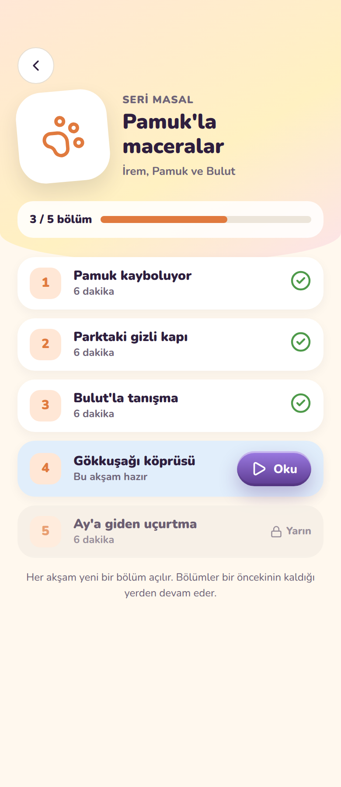

| | |
|---|---|
| Alan | Çocuk alanı |
| Rota | `series(id)` |
| Sunum | push |
| Boyut | 390 × 900 pt (prototip artboard) |
| Kaynak | `reference/html/SeriMasal.dc.html` |

**Amaç.** Seri masal: 5 bölüm, okunanlar tikli, bu akşamki açık, sonraki yarın.

**Veri.** Series + Story Bible bölümleri.

**Uygulama notları.** Bölüm kilidi backend kuralı (günde bir bölüm).

**Gezinme (dokununca nereye gider).**
- "Geri" → 16 · Kitaplık (tam sayfa)
- "Oku" → 22 · Okuyucu · görselli

<details><summary>Ekrandaki metinler</summary>

```text
SERİ MASAL
Pamuk'la maceralar
İrem, Pamuk ve Bulut
3 / 5 bölüm
Pamuk kayboluyor
6 dakika
Parktaki gizli kapı
Bulut'la tanışma
Gökkuşağı köprüsü
Bu akşam hazır
Oku
Ay'a giden uçurtma
Yarın
Her akşam yeni bir bölüm açılır. Bölümler bir öncekinin kaldığı yerden devam eder.
```
</details>

---

## 19 · Yarat 1 · Dünya (tam sayfa)
<a id="19-sihirbaznerede"></a>

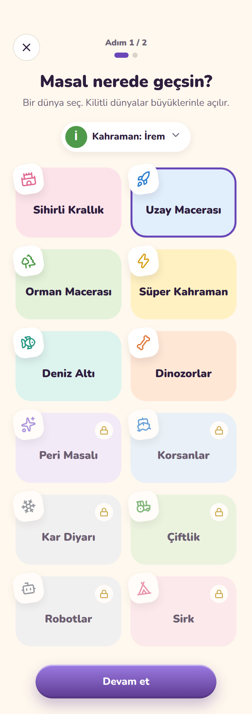

| | |
|---|---|
| Alan | Masal oluşturma ve okuma |
| Rota | `create(step: .world)` |
| Sunum | fullScreen |
| Boyut | 390 × 1100 pt (prototip artboard) |
| Kaynak | `reference/html/SihirbazNerede.dc.html` |

**Amaç.** Yarat 1/2: dünya seçimi, kahraman çipi.

**Veri.** Dünya kataloğu, profiller.

**Uygulama notları.** 12 dünya 2 sütun; kilitliler %70 opak + kilit. Kahraman çipi profiller arasında döner. X ile çıkış.

**Gezinme (dokununca nereye gider).**
- "Kapat" → 11 · Ana sayfa (tam sayfa)
- "Devam et" → 20 · Yarat 2 · Ayarla (tam sayfa)

**Ekran içi kontroller.** `İ Kahraman: İrem` · `Sihirli Krallık` · `Uzay Macerası` · `Orman Macerası` · `Süper Kahraman` · `Deniz Altı` · `Dinozorlar` · `Peri Masalı` · `Korsanlar` · `Kar Diyarı` · `Çiftlik` · `Robotlar` · `Sirk`

**Durum görüntüleri.** [Kahraman çipi Elif](../screens/state-SihirbazNerede-elif.png)

<details><summary>Ekrandaki metinler</summary>

```text
Adım 1 / 2
Masal nerede geçsin?
Bir dünya seç. Kilitli dünyalar büyüklerinle açılır.
Kahraman: İrem
Sihirli Krallık
Uzay Macerası
Orman Macerası
Süper Kahraman
Deniz Altı
Dinozorlar
Peri Masalı
Korsanlar
Kar Diyarı
Çiftlik
Robotlar
Sirk
Devam et
```
</details>

---

## 20 · Yarat 2 · Ayarla (tam sayfa)
<a id="20-sihirbaznasil"></a>

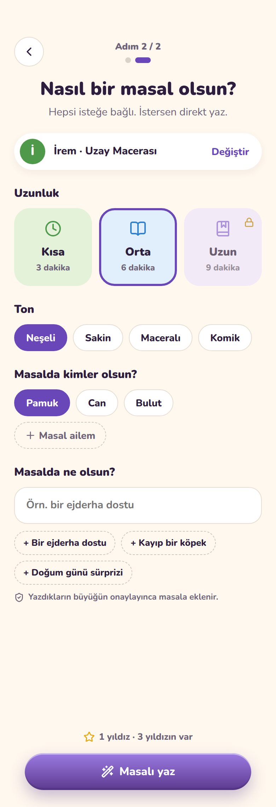

| | |
|---|---|
| Alan | Masal oluşturma ve okuma |
| Rota | `create(step: .details)` |
| Sunum | push (create stack) |
| Boyut | 390 × 1140 pt (prototip artboard) |
| Kaynak | `reference/html/SihirbazNasil.dc.html` |

**Amaç.** Yarat 2/2: uzunluk, ton, karakterler, 'Masalda ne olsun?' alanı, yıldız bilgisi, Masalı yaz.

**Veri.** StoryRequest alanları.

**Uygulama notları.** Serbest metin 80 karakter; altında 'büyüğün onaylayınca' notu (onaylı modda). Uzun = kilitli (premium).

**Gezinme (dokununca nereye gider).**
- "Geri" → 19 · Yarat 1 · Dünya (tam sayfa)
- "Değiştir" → 19 · Yarat 1 · Dünya (tam sayfa)
- "Masal ailem" → 14 · Masal ailem
- "Masalı yaz" → 21 · Masal yazılıyor

**Ekran içi kontroller.** `Kısa 3 dakika` · `Orta 6 dakika` · `Uzun 9 dakika` · `Neşeli` · `Sakin` · `Maceralı` · `Komik` · `Pamuk` · `Can` · `Bulut` · `+ Bir ejderha dostu` · `+ Kayıp bir köpek` · `+ Doğum günü sürprizi`

**Alanlar.** Örn. bir ejderha dostu (placeholder: "Örn. bir ejderha dostu")

<details><summary>Ekrandaki metinler</summary>

```text
Adım 2 / 2
Nasıl bir masal olsun?
Hepsi isteğe bağlı. İstersen direkt yaz.
İrem · Uzay Macerası
Değiştir
Uzunluk
Kısa
3 dakika
Orta
6 dakika
Uzun
9 dakika
Ton
Neşeli
Sakin
Maceralı
Komik
Masalda kimler olsun?
Pamuk
Can
Bulut
Masal ailem
Masalda ne olsun?
+ Bir ejderha dostu
+ Kayıp bir köpek
+ Doğum günü sürprizi
Yazdıkların büyüğün onaylayınca masala eklenir.
1 yıldız · 3 yıldızın var
Masalı yaz
```
</details>

---

## 21 · Masal yazılıyor
<a id="21-uretim"></a>

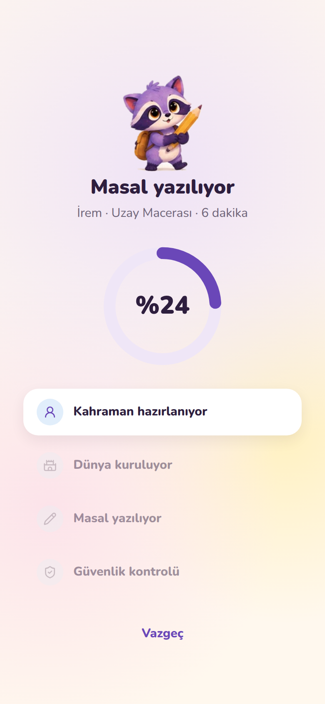

| | |
|---|---|
| Alan | Masal oluşturma ve okuma |
| Rota | `generating(jobId)` |
| Sunum | push (create stack) |
| Boyut | 390 × 844 pt (prototip artboard) |
| Kaynak | `reference/html/Uretim.dc.html` |

**Amaç.** Masal yazılıyor: kalemli rakun, halka, aşamalar, Vazgeç.

**Veri.** SSE job events.

**Uygulama notları.** Bitince 'Masalı oku' (state-Uretim-bitti). Live Activity ile eşleşir.

**Gezinme (dokununca nereye gider).**
- "Vazgeç" → 11 · Ana sayfa (tam sayfa)

**Durum görüntüleri.** [Masal hazır](../screens/state-Uretim-bitti.png)

<details><summary>Ekrandaki metinler</summary>

```text
Masal yazılıyor
İrem · Uzay Macerası · 6 dakika
%28
Kahraman hazırlanıyor
Dünya kuruluyor
Güvenlik kontrolü
Vazgeç
```
</details>

---

## 22 · Okuyucu · görselli
<a id="22-okuyucugorselli"></a>

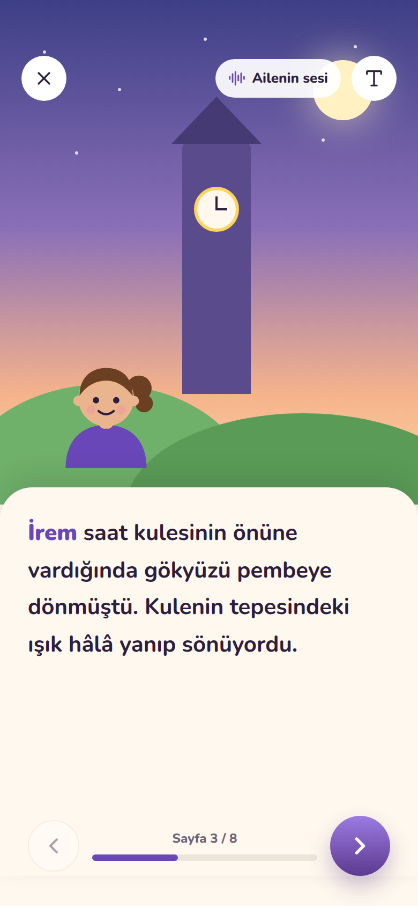

| | |
|---|---|
| Alan | Masal oluşturma ve okuma |
| Rota | `reader(id, mode: .illustrated)` |
| Sunum | fullScreen |
| Boyut | 390 × 844 pt (prototip artboard) |
| Kaynak | `reference/html/OkuyucuGorselli.dc.html` |

**Amaç.** Görselli okuyucu: üstte tam genişlik resim, altta kayan metin paneli, sayfa ilerleme, ses chip'i.

**Veri.** StoryResponse.pages + images.

**Uygulama notları.** Son sayfada ileri butonu bayrağa döner → Masal sonu.

**Gezinme (dokununca nereye gider).**
- "Kapat" → 11 · Ana sayfa (tam sayfa)
- "Ailenin sesi" → 24 · Okuma ayarları
- "Okuma ayarları" → 24 · Okuma ayarları

**Ekran içi kontroller.** `Önceki sayfa` · `Sonraki sayfa`

**Durum görüntüleri.** [Son sayfa, bitir bayrağı](../screens/state-OkuyucuGorselli-sayfa4.png)

<details><summary>Ekrandaki metinler</summary>

```text
Ailenin sesi
İrem saat kulesinin önüne vardığında gökyüzü pembeye dönmüştü. Kulenin tepesindeki ışık hâlâ yanıp sönüyordu.
Sayfa 3 / 8
```
</details>

---

## 23 · Okuyucu · sadece metin
<a id="23-okuyucu"></a>

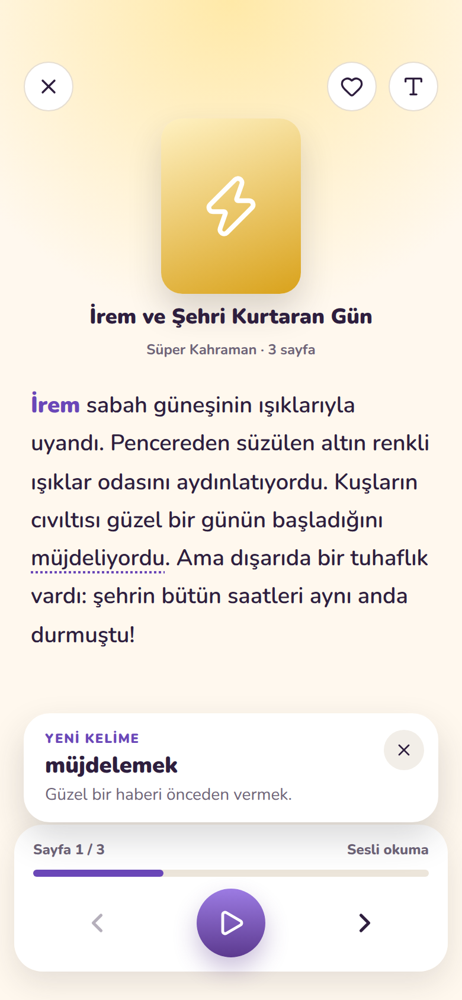

| | |
|---|---|
| Alan | Masal oluşturma ve okuma |
| Rota | `reader(id, mode: .text)` |
| Sunum | fullScreen |
| Boyut | 390 × 844 pt (prototip artboard) |
| Kaynak | `reference/html/Okuyucu.dc.html` |

**Amaç.** Metin okuyucu: kapak, metin, yeni kelime popover, sesli okuma kontrol çubuğu.

**Veri.** StoryResponse.

**Uygulama notları.** 3 tema (Gündüz/Sepya/Gece) → ReaderTheme. Yeni kelime noktalı altı çizili, dokununca kart.

**Gezinme (dokununca nereye gider).**
- "Kapat" → 11 · Ana sayfa (tam sayfa)
- "Okuma ayarları" → 24 · Okuma ayarları

**Ekran içi kontroller.** `Favorilere ekle` · `müjdeliyordu` · `Kapat` · `Önceki sayfa` · `Sesli oku` · `Sonraki sayfa`

<details><summary>Ekrandaki metinler</summary>

```text
İrem ve Şehri Kurtaran Gün
Süper Kahraman · 3 sayfa
İrem sabah güneşinin ışıklarıyla uyandı. Pencereden süzülen altın renkli ışıklar odasını aydınlatıyordu. Kuşların cıvıltısı güzel bir günün başladığını müjdeliyordu. Ama dışarıda bir tuhaflık vardı: şehrin bütün saatleri aynı anda durmuştu!
YENİ KELİME
müjdelemek
Güzel bir haberi önceden vermek.
Sayfa 1 / 3
Sesli okuma
```
</details>

---

## 24 · Okuma ayarları
<a id="24-okumaayarlari"></a>

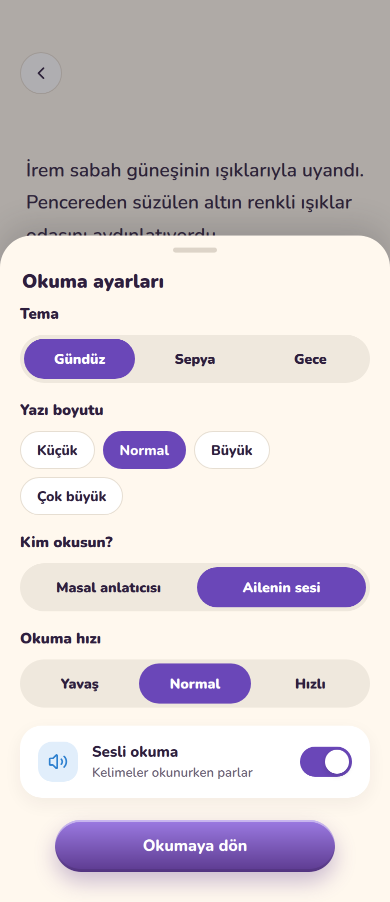

| | |
|---|---|
| Alan | Masal oluşturma ve okuma |
| Rota | `readerSettings` |
| Sunum | sheet |
| Boyut | 390 × 900 pt (prototip artboard) |
| Kaynak | `reference/html/OkumaAyarlari.dc.html` |

**Amaç.** Okuma ayarları: tema, yazı boyutu, kim okusun, okuma hızı, sesli okuma.

**Veri.** ReaderPreferences.

**Uygulama notları.** 'Ailenin sesi' kayıt varsa aktif.

**Gezinme (dokununca nereye gider).**
- "Geri" → 23 · Okuyucu · sadece metin
- "Okumaya dön" → 23 · Okuyucu · sadece metin

**Ekran içi kontroller.** `Gündüz` · `Sepya` · `Gece` · `Küçük` · `Normal` · `Büyük` · `Çok büyük` · `Masal anlatıcısı` · `Ailenin sesi` · `Yavaş` · `Hızlı`

<details><summary>Ekrandaki metinler</summary>

```text
İrem sabah güneşinin ışıklarıyla uyandı. Pencereden süzülen altın renkli ışıklar odasını aydınlatıyordu.
Okuma ayarları
Tema
Gündüz
Sepya
Gece
Yazı boyutu
Küçük
Normal
Büyük
Çok büyük
Kim okusun?
Masal anlatıcısı
Ailenin sesi
Okuma hızı
Yavaş
Hızlı
Sesli okuma
Kelimeler okunurken parlar
Okumaya dön
```
</details>

---

## 25 · Masal sonu
<a id="25-masalsonu"></a>

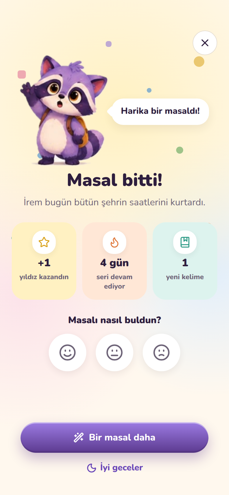

| | |
|---|---|
| Alan | Masal oluşturma ve okuma |
| Rota | `storyEnd(id)` |
| Sunum | push (reader stack) |
| Boyut | 390 × 844 pt (prototip artboard) |
| Kaynak | `reference/html/MasalSonu.dc.html` |

**Amaç.** Masal sonu: el sallayan rakun, ödüller (+1 yıldız, seri, kelime), puanlama, Bir masal daha / İyi geceler.

**Veri.** Ödül hesabı (backend).

**Uygulama notları.** Kutlama 400 ms, Reduce Motion'da konfeti yok. Paywall'ın doğru anı burası değil, ebeveyne sonradan.

**Gezinme (dokununca nereye gider).**
- "Kapat" → 11 · Ana sayfa (tam sayfa)
- "1 yeni kelime" → 15 · Yeni kelimelerim
- "Bir masal daha" → 19 · Yarat 1 · Dünya (tam sayfa)
- "İyi geceler" → 26 · Uyku modu

**Ekran içi kontroller.** `Çok sevdim` · `Fena değil` · `Sevmedim`

<details><summary>Ekrandaki metinler</summary>

```text
Harika bir masaldı!
Masal bitti!
İrem bugün bütün şehrin saatlerini kurtardı.
+1
yıldız kazandın
4 gün
seri devam ediyor
yeni kelime
Masalı nasıl buldun?
Bir masal daha
İyi geceler
```
</details>

---

## 26 · Uyku modu
<a id="26-uykumodu"></a>

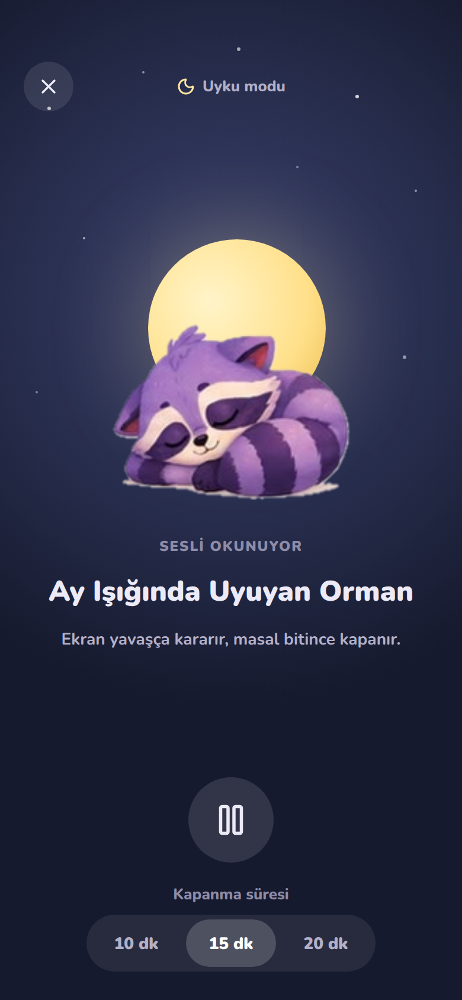

| | |
|---|---|
| Alan | Masal oluşturma ve okuma |
| Rota | `sleepMode` |
| Sunum | fullScreen |
| Boyut | 390 × 844 pt (prototip artboard) |
| Kaynak | `reference/html/UykuModu.dc.html` |

**Amaç.** Uyku modu: koyu gece, ay + uyuyan rakun, sesli okuma, kapanma süresi.

**Veri.** Seslendirme, timer.

**Uygulama notları.** Ekran parlaklığı düşürülebilir; süre bitince kapanır.

**Gezinme (dokununca nereye gider).**
- "Uyku modundan çık" → 11 · Ana sayfa (tam sayfa)

**Ekran içi kontroller.** `Oynat veya duraklat` · `10 dk` · `15 dk` · `20 dk`

<details><summary>Ekrandaki metinler</summary>

```text
Uyku modu
SESLİ OKUNUYOR
Ay Işığında Uyuyan Orman
Ekran yavaşça kararır, masal bitince kapanır.
Kapanma süresi
10 dk
15 dk
20 dk
```
</details>

---

## 27 · iPad · yatay okuyucu
<a id="27-ipadokuyucu"></a>

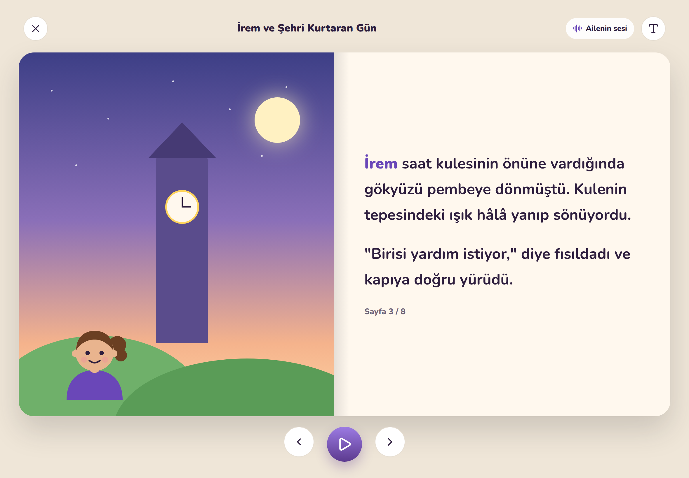

| | |
|---|---|
| Alan | Masal oluşturma ve okuma |
| Rota | `reader(id, mode: .illustrated) [iPad]` |
| Sunum | fullScreen (regular width) |
| Boyut | 1180 × 820 pt (prototip artboard) |
| Kaynak | `reference/html/iPadOkuyucu.dc.html` |

**Amaç.** iPad yatay okuyucu: sol sayfa resim, sağ sayfa metin, ortada sırt gölgesi.

**Veri.** StoryResponse.

**Uygulama notları.** horizontalSizeClass == .regular ise bu düzen.

**Gezinme (dokununca nereye gider).**
- "Kapat" → 11 · Ana sayfa (tam sayfa)
- "Ailenin sesi" → 24 · Okuma ayarları
- "Okuma ayarları" → 24 · Okuma ayarları
- "Sonraki sayfa" → 25 · Masal sonu

**Ekran içi kontroller.** `Önceki sayfa` · `Sesli oku`

<details><summary>Ekrandaki metinler</summary>

```text
İrem ve Şehri Kurtaran Gün
Ailenin sesi
İrem saat kulesinin önüne vardığında gökyüzü pembeye dönmüştü. Kulenin tepesindeki ışık hâlâ yanıp sönüyordu.
"Birisi yardım istiyor," diye fısıldadı ve kapıya doğru yürüdü.
Sayfa 3 / 8
```
</details>

---

## 28 · Ebeveyn kapısı
<a id="28-ebeveynkapisi"></a>

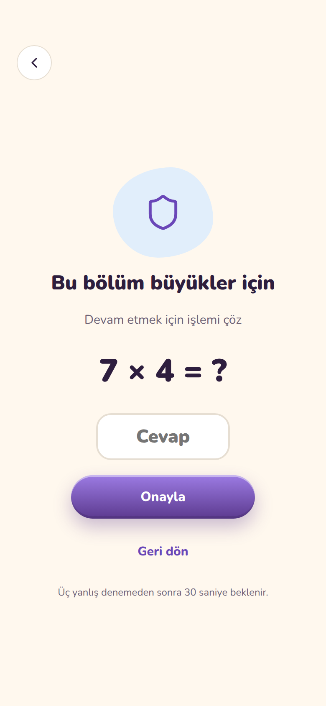

| | |
|---|---|
| Alan | Ebeveyn alanı |
| Rota | `parentGate` |
| Sunum | fullScreen |
| Boyut | 390 × 844 pt (prototip artboard) |
| Kaynak | `reference/html/EbeveynKapisi.dc.html` |

**Amaç.** Ebeveyn kapısı: çarpma işlemi sorusu.

**Veri.** Rastgele soru.

**Uygulama notları.** 3 yanlışta 30 sn bekleme. Doğru → ebeveyn alanı (fullScreenCover). Hata durumu state-EbeveynKapisi-hata.

**Gezinme (dokununca nereye gider).**
- "Geri" → 11 · Ana sayfa (tam sayfa)
- "Geri dön" → 11 · Ana sayfa (tam sayfa)

**Ekran içi kontroller.** `Onayla`

**Alanlar.** Cevap (placeholder: "Cevap")

**Durum görüntüleri.** [Yanlış cevap](../screens/state-EbeveynKapisi-hata.png)

<details><summary>Ekrandaki metinler</summary>

```text
Bu bölüm büyükler için
Devam etmek için işlemi çöz
7 × 4 = ?
Onayla
Geri dön
Üç yanlış denemeden sonra 30 saniye beklenir.
```
</details>

---

## 29 · Ebeveyn · Özet (tam sayfa)
<a id="29-ebeveynpaneli"></a>

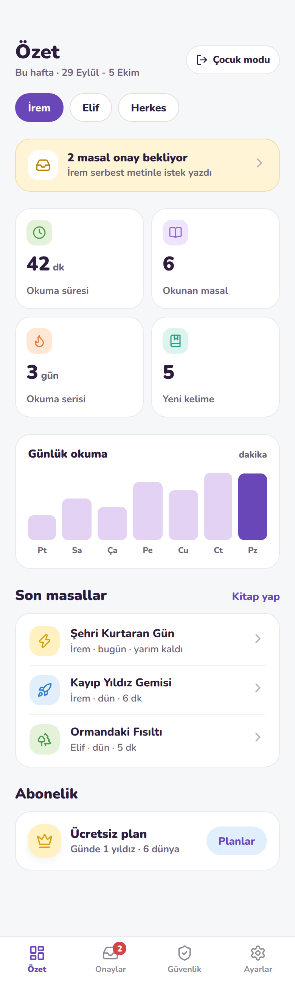

| | |
|---|---|
| Alan | Ebeveyn alanı |
| Rota | `parent(.summary)` |
| Sunum | tab root |
| Boyut | 390 × 1320 pt (prototip artboard) |
| Kaynak | `reference/html/EbeveynPaneli.dc.html` |

**Amaç.** Özet: çocuk filtresi, onay uyarısı, 4 istatistik, günlük okuma grafiği, son masallar, abonelik.

**Veri.** Haftalık okuma istatistiği.

**Uygulama notları.** Grafik: Swift Charts BarMark, bugünkü bar mor.

**Gezinme (dokununca nereye gider).**
- "Çocuk modu" → 11 · Ana sayfa (tam sayfa)
- "2 masal onay bekliyor İrem serbest metinle istek yazdı" → 30 · Ebeveyn · Onaylar (tam sayfa)
- "Kitap yap" → 35 · Masal kitabı
- "Planlar" → 37 · Abonelik
- "Özet" → 29 · Ebeveyn · Özet (tam sayfa)
- "2 Onaylar" → 30 · Ebeveyn · Onaylar (tam sayfa)
- "Güvenlik" → 31 · Ebeveyn · Güvenlik (tam sayfa)
- "Ayarlar" → 32 · Ebeveyn · Ayarlar (tam sayfa)

**Ekran içi kontroller.** `İrem` · `Elif` · `Herkes`

<details><summary>Ekrandaki metinler</summary>

```text
Özet
Bu hafta · 29 Eylül - 5 Ekim
Çocuk modu
İrem
Elif
Herkes
2 masal onay bekliyor
İrem serbest metinle istek yazdı
42 dk
Okuma süresi
Okunan masal
3 gün
Okuma serisi
Yeni kelime
Günlük okuma
dakika
Pt
Sa
Ça
Pe
Cu
Ct
Pz
Son masallar
Kitap yap
Şehri Kurtaran Gün
İrem · bugün · yarım kaldı
Kayıp Yıldız Gemisi
İrem · dün · 6 dk
Ormandaki Fısıltı
Elif · dün · 5 dk
Abonelik
Ücretsiz plan
Günde 1 yıldız · 6 dünya
Planlar
Onaylar
Güvenlik
Ayarlar
```
</details>

---

## 30 · Ebeveyn · Onaylar (tam sayfa)
<a id="30-onaybekleyenler"></a>

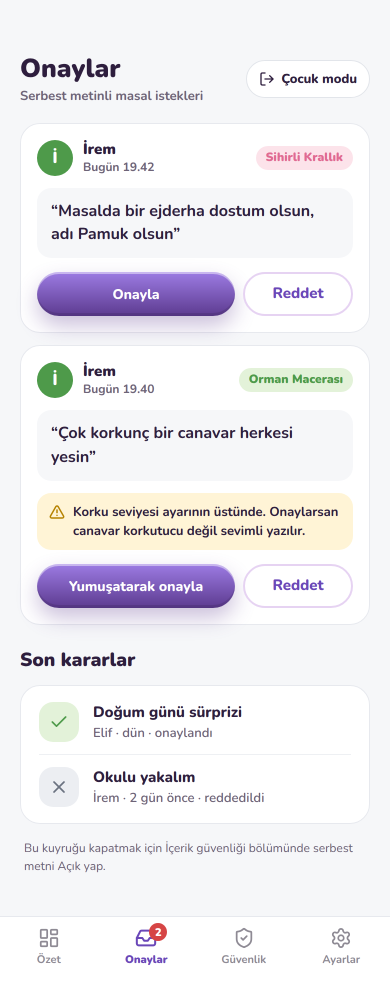

| | |
|---|---|
| Alan | Ebeveyn alanı |
| Rota | `parent(.approvals)` |
| Sunum | tab root |
| Boyut | 390 × 1000 pt (prototip artboard) |
| Kaynak | `reference/html/OnayBekleyenler.dc.html` |

**Amaç.** Onaylar: serbest metinli istek kartları, Onayla / Yumuşatarak onayla / Reddet, son kararlar.

**Veri.** POST /v1/approvals/{jobId}.

**Uygulama notları.** Sınırda istekte sarı uyarı ve 'Yumuşatarak onayla'.

**Gezinme (dokununca nereye gider).**
- "Çocuk modu" → 11 · Ana sayfa (tam sayfa)
- "Özet" → 29 · Ebeveyn · Özet (tam sayfa)
- "2 Onaylar" → 30 · Ebeveyn · Onaylar (tam sayfa)
- "Güvenlik" → 31 · Ebeveyn · Güvenlik (tam sayfa)
- "Ayarlar" → 32 · Ebeveyn · Ayarlar (tam sayfa)

**Ekran içi kontroller.** `Onayla` · `Reddet` · `Yumuşatarak onayla`

**Durum görüntüleri.** [İlk istek onaylandı](../screens/state-Onaylar-karar.png)

<details><summary>Ekrandaki metinler</summary>

```text
Onaylar
Serbest metinli masal istekleri
Çocuk modu
İrem
Bugün 19.42
Sihirli Krallık
“Masalda bir ejderha dostum olsun, adı Pamuk olsun”
Onayla
Reddet
Bugün 19.40
Orman Macerası
“Çok korkunç bir canavar herkesi yesin”
Korku seviyesi ayarının üstünde. Onaylarsan canavar korkutucu değil sevimli yazılır.
Yumuşatarak onayla
Son kararlar
Doğum günü sürprizi
Elif · dün · onaylandı
Okulu yakalım
İrem · 2 gün önce · reddedildi
Bu kuyruğu kapatmak için İçerik güvenliği bölümünde serbest metni Açık yap.
Özet
Güvenlik
Ayarlar
```
</details>

---

## 31 · Ebeveyn · Güvenlik (tam sayfa)
<a id="31-icerikguvenligi"></a>

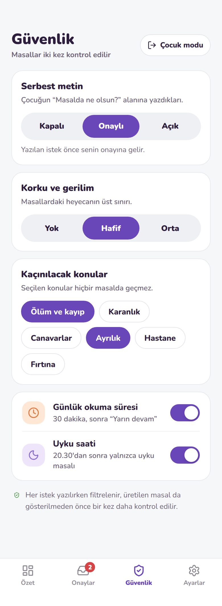

| | |
|---|---|
| Alan | Ebeveyn alanı |
| Rota | `parent(.safety)` |
| Sunum | tab root |
| Boyut | 390 × 1060 pt (prototip artboard) |
| Kaynak | `reference/html/IcerikGuvenligi.dc.html` |

**Amaç.** Güvenlik: serbest metin modu, korku seviyesi, kaçınılacak konular, okuma süresi, uyku saati.

**Veri.** ParentSettings (sunucuda doğruluk kaynağı).

**Uygulama notları.** Varsayılan en korumacı seçenek.

**Gezinme (dokununca nereye gider).**
- "Çocuk modu" → 11 · Ana sayfa (tam sayfa)
- "Özet" → 29 · Ebeveyn · Özet (tam sayfa)
- "2 Onaylar" → 30 · Ebeveyn · Onaylar (tam sayfa)
- "Güvenlik" → 31 · Ebeveyn · Güvenlik (tam sayfa)
- "Ayarlar" → 32 · Ebeveyn · Ayarlar (tam sayfa)

**Ekran içi kontroller.** `Kapalı` · `Onaylı` · `Açık` · `Yok` · `Hafif` · `Orta` · `Ölüm ve kayıp` · `Karanlık` · `Canavarlar` · `Ayrılık` · `Hastane` · `Fırtına`

<details><summary>Ekrandaki metinler</summary>

```text
Güvenlik
Masallar iki kez kontrol edilir
Çocuk modu
Serbest metin
Çocuğun “Masalda ne olsun?” alanına yazdıkları.
Kapalı
Onaylı
Açık
Yazılan istek önce senin onayına gelir.
Korku ve gerilim
Masallardaki heyecanın üst sınırı.
Yok
Hafif
Orta
Kaçınılacak konular
Seçilen konular hiçbir masalda geçmez.
Ölüm ve kayıp
Karanlık
Canavarlar
Ayrılık
Hastane
Fırtına
Günlük okuma süresi
30 dakika, sonra “Yarın devam”
Uyku saati
20.30'dan sonra yalnızca uyku masalı
Her istek yazılırken filtrelenir, üretilen masal da gösterilmeden önce bir kez daha kontrol edilir.
Özet
Onaylar
Ayarlar
```
</details>

---

## 32 · Ebeveyn · Ayarlar (tam sayfa)
<a id="32-ayarlar"></a>

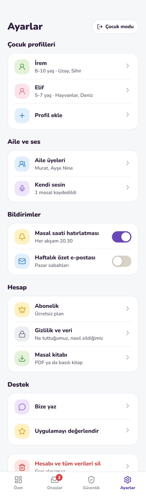

| | |
|---|---|
| Alan | Ebeveyn alanı |
| Rota | `parent(.settings)` |
| Sunum | tab root |
| Boyut | 390 × 1340 pt (prototip artboard) |
| Kaynak | `reference/html/Ayarlar.dc.html` |

**Amaç.** Ayarlar: profiller, aile ve ses, bildirimler, hesap, destek, hesabı sil.

**Veri.** Hesap, profiller.

**Uygulama notları.** Gruplanmış liste, ebeveyn kartları.

**Gezinme (dokununca nereye gider).**
- "Çocuk modu" → 11 · Ana sayfa (tam sayfa)
- "Profil ekle" → 07 · Çocuk profili
- "Aile üyeleri Murat, Ayşe Nine" → 34 · Aile üyeleri
- "Kendi sesin 1 masal kaydedildi" → 33 · Kendi sesin
- "Abonelik Ücretsiz plan" → 37 · Abonelik
- "Masal kitabı PDF ya da basılı kitap" → 35 · Masal kitabı
- "Hesabı ve tüm verileri sil Geri alınamaz" → 39 · Hesabı sil
- "Özet" → 29 · Ebeveyn · Özet (tam sayfa)
- "2 Onaylar" → 30 · Ebeveyn · Onaylar (tam sayfa)
- "Güvenlik" → 31 · Ebeveyn · Güvenlik (tam sayfa)
- "Ayarlar" → 32 · Ebeveyn · Ayarlar (tam sayfa)

<details><summary>Ekrandaki metinler</summary>

```text
Ayarlar
Çocuk modu
Çocuk profilleri
İrem
8-10 yaş · Uzay, Sihir
Elif
5-7 yaş · Hayvanlar, Deniz
Profil ekle
Aile ve ses
Aile üyeleri
Murat, Ayşe Nine
Kendi sesin
1 masal kaydedildi
Bildirimler
Masal saati hatırlatması
Her akşam 20.30
Haftalık özet e-postası
Pazar sabahları
Hesap
Abonelik
Ücretsiz plan
Gizlilik ve veri
Ne tuttuğumuz, nasıl sildiğimiz
Masal kitabı
PDF ya da basılı kitap
Destek
Bize yaz
Uygulamayı değerlendir
Hesabı ve tüm verileri sil
Geri alınamaz
Özet
Onaylar
Güvenlik
```
</details>

---

## 33 · Kendi sesin
<a id="33-seskaydi"></a>

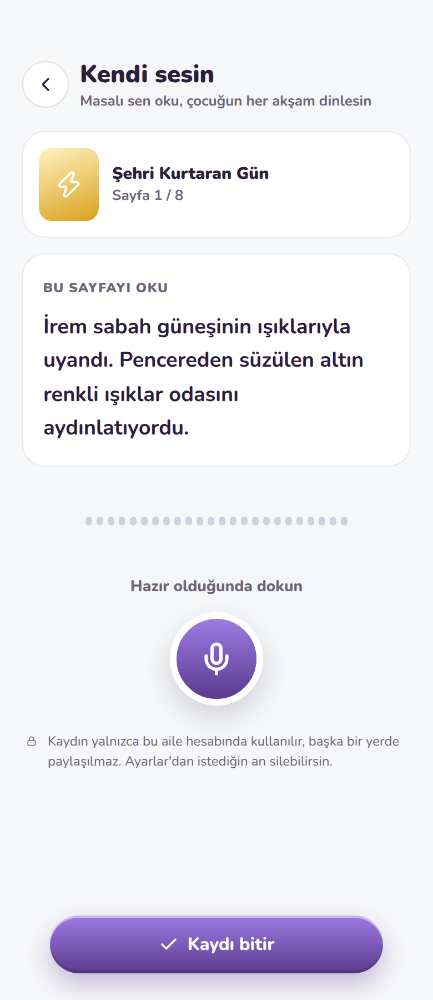

| | |
|---|---|
| Alan | Ebeveyn alanı |
| Rota | `voiceRecording` |
| Sunum | push |
| Boyut | 390 × 900 pt (prototip artboard) |
| Kaynak | `reference/html/SesKaydi.dc.html` |

**Amaç.** Kendi sesin: masalı sayfa sayfa kaydet.

**Veri.** AVAudioRecorder, yükleme.

**Uygulama notları.** Kayıt sürerken kırmızı buton ve dalga (state-SesKaydi-kayit). Gizlilik notu zorunlu.

**Gezinme (dokununca nereye gider).**
- "Geri" → 32 · Ebeveyn · Ayarlar (tam sayfa)
- "Kaydı bitir" → 32 · Ebeveyn · Ayarlar (tam sayfa)

**Ekran içi kontroller.** `Kaydet`

**Durum görüntüleri.** [Kayıt sürüyor](../screens/state-SesKaydi-kayit.png)

<details><summary>Ekrandaki metinler</summary>

```text
Kendi sesin
Masalı sen oku, çocuğun her akşam dinlesin
Şehri Kurtaran Gün
Sayfa 1 / 8
BU SAYFAYI OKU
İrem sabah güneşinin ışıklarıyla uyandı. Pencereden süzülen altın renkli ışıklar odasını aydınlatıyordu.
Hazır olduğunda dokun
Kaydın yalnızca bu aile hesabında kullanılır, başka bir yerde paylaşılmaz. Ayarlar'dan istediğin an silebilirsin.
Kaydı bitir
```
</details>

---

## 34 · Aile üyeleri
<a id="34-aileuyeleri"></a>

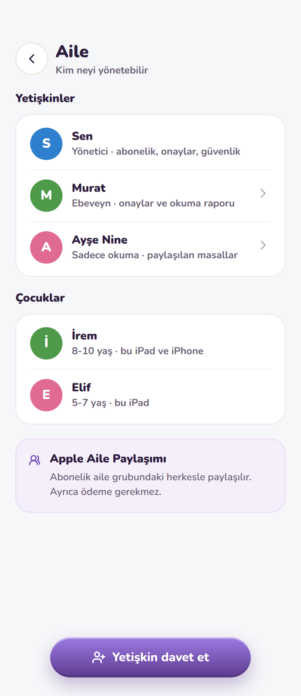

| | |
|---|---|
| Alan | Ebeveyn alanı |
| Rota | `familyMembers` |
| Sunum | push |
| Boyut | 390 × 900 pt (prototip artboard) |
| Kaynak | `reference/html/AileUyeleri.dc.html` |

**Amaç.** Aile: yetişkinler (rol), çocuklar, Apple Aile Paylaşımı bilgisi, davet.

**Veri.** Family roles.

**Uygulama notları.** Roller: yönetici, ebeveyn, sadece okuma.

**Gezinme (dokununca nereye gider).**
- "Geri" → 32 · Ebeveyn · Ayarlar (tam sayfa)

**Ekran içi kontroller.** `Yetişkin davet et`

<details><summary>Ekrandaki metinler</summary>

```text
Aile
Kim neyi yönetebilir
Yetişkinler
Sen
Yönetici · abonelik, onaylar, güvenlik
Murat
Ebeveyn · onaylar ve okuma raporu
Ayşe Nine
Sadece okuma · paylaşılan masallar
Çocuklar
İrem
8-10 yaş · bu iPad ve iPhone
Elif
5-7 yaş · bu iPad
Apple Aile Paylaşımı
Abonelik aile grubundaki herkesle paylaşılır. Ayrıca ödeme gerekmez.
Yetişkin davet et
```
</details>

---

## 35 · Masal kitabı
<a id="35-kitapsiparisi"></a>

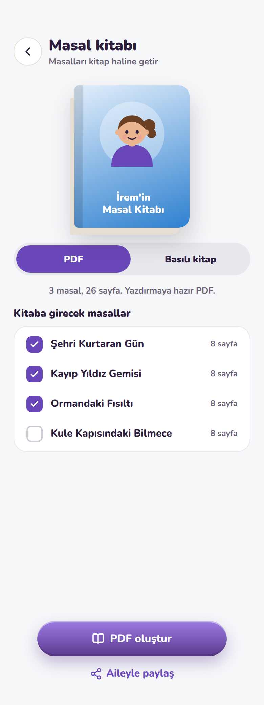

| | |
|---|---|
| Alan | Ebeveyn alanı |
| Rota | `bookExport` |
| Sunum | push |
| Boyut | 390 × 1040 pt (prototip artboard) |
| Kaynak | `reference/html/KitapSiparisi.dc.html` |

**Amaç.** Masal kitabı: PDF ya da basılı kitap, masal seçimi.

**Veri.** Seçili masallar.

**Uygulama notları.** Basılı fiyatı henüz yok.

**Gezinme (dokununca nereye gider).**
- "Geri" → 29 · Ebeveyn · Özet (tam sayfa)
- "Aileyle paylaş" → 36 · Aileyle paylaş

**Ekran içi kontroller.** `PDF` · `Basılı kitap` · `Şehri Kurtaran Gün 8 sayfa` · `Kayıp Yıldız Gemisi 8 sayfa` · `Ormandaki Fısıltı 8 sayfa` · `Kule Kapısındaki Bilmece 8 sayfa` · `PDF oluştur`

<details><summary>Ekrandaki metinler</summary>

```text
Masal kitabı
Masalları kitap haline getir
İrem'in
Masal Kitabı
PDF
Basılı kitap
3 masal, 26 sayfa. Yazdırmaya hazır PDF.
Kitaba girecek masallar
Şehri Kurtaran Gün
8 sayfa
Kayıp Yıldız Gemisi
Ormandaki Fısıltı
Kule Kapısındaki Bilmece
PDF oluştur
Aileyle paylaş
```
</details>

---

## 36 · Aileyle paylaş
<a id="36-paylas"></a>

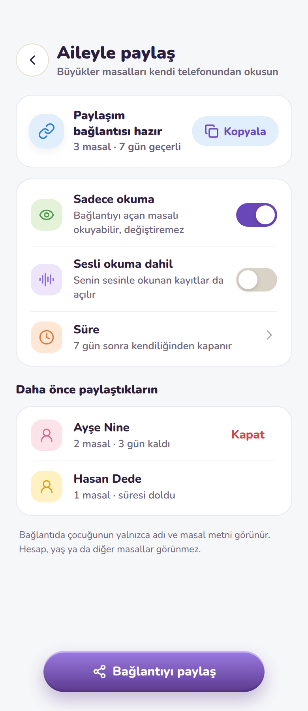

| | |
|---|---|
| Alan | Ebeveyn alanı |
| Rota | `shareLink` |
| Sunum | push |
| Boyut | 390 × 900 pt (prototip artboard) |
| Kaynak | `reference/html/Paylas.dc.html` |

**Amaç.** Aileyle paylaş: süreli bağlantı, izinler, önceki paylaşımlar.

**Veri.** Share link API.

**Uygulama notları.** Bağlantıda yalnızca ad ve masal metni.

**Gezinme (dokununca nereye gider).**
- "Geri" → 35 · Masal kitabı

**Ekran içi kontroller.** `Kopyala` · `Kapat` · `Bağlantıyı paylaş`

<details><summary>Ekrandaki metinler</summary>

```text
Aileyle paylaş
Büyükler masalları kendi telefonundan okusun
Paylaşım bağlantısı hazır
3 masal · 7 gün geçerli
Kopyala
Sadece okuma
Bağlantıyı açan masalı okuyabilir, değiştiremez
Sesli okuma dahil
Senin sesinle okunan kayıtlar da açılır
Süre
7 gün sonra kendiliğinden kapanır
Daha önce paylaştıkların
Ayşe Nine
2 masal · 3 gün kaldı
Kapat
Hasan Dede
1 masal · süresi doldu
Bağlantıda çocuğunun yalnızca adı ve masal metni görünür. Hesap, yaş ya da diğer masallar görünmez.
Bağlantıyı paylaş
```
</details>

---

## 37 · Abonelik
<a id="37-paywall"></a>

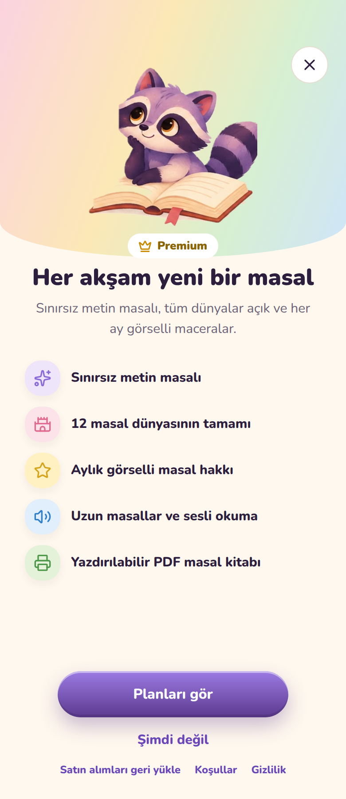

| | |
|---|---|
| Alan | Ebeveyn alanı |
| Rota | `paywall` |
| Sunum | sheet / push (only from parent area) |
| Boyut | 390 × 900 pt (prototip artboard) |
| Kaynak | `reference/html/Paywall.dc.html` |

**Amaç.** Abonelik: faydalar, sonra planlar (aylık/yıllık), 7 gün ücretsiz.

**Veri.** StoreKit 2 Product.

**Uygulama notları.** İki adım (state-Paywall-planlar). Geri yükle, koşullar, gizlilik linkleri zorunlu. Fiyatlar: Hikaye Kahramanı ₺149/ay ₺1.190/yıl, Yıldız Kaşifi ₺89/ay ₺690/yıl (StoreKit'ten okunmalı).

**Gezinme (dokununca nereye gider).**
- "Kapat" → 29 · Ebeveyn · Özet (tam sayfa)
- "Şimdi değil" → 29 · Ebeveyn · Özet (tam sayfa)

**Ekran içi kontroller.** `Planları gör`

**Durum görüntüleri.** [Planlar açık (2. adım)](../screens/state-Paywall-planlar.png)

<details><summary>Ekrandaki metinler</summary>

```text
Premium
Her akşam yeni bir masal
Sınırsız metin masalı, tüm dünyalar açık ve her ay görselli maceralar.
Sınırsız metin masalı
12 masal dünyasının tamamı
Aylık görselli masal hakkı
Uzun masallar ve sesli okuma
Yazdırılabilir PDF masal kitabı
Planları gör
Şimdi değil
Satın alımları geri yükle
Koşullar
Gizlilik
```
</details>

---

## 38 · Abonelik bitti
<a id="38-abonelikbitti"></a>

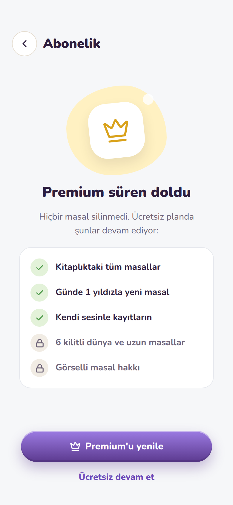

| | |
|---|---|
| Alan | Ebeveyn alanı |
| Rota | `subscriptionExpired` |
| Sunum | push |
| Boyut | 390 × 844 pt (prototip artboard) |
| Kaynak | `reference/html/AbonelikBitti.dc.html` |

**Amaç.** Premium süresi doldu: ne kalır, ne kilitlenir.

**Veri.** Entitlement.

**Uygulama notları.** Hiçbir masal silinmez mesajı.

**Gezinme (dokununca nereye gider).**
- "Geri" → 29 · Ebeveyn · Özet (tam sayfa)
- "Premium'u yenile" → 37 · Abonelik
- "Ücretsiz devam et" → 29 · Ebeveyn · Özet (tam sayfa)

<details><summary>Ekrandaki metinler</summary>

```text
Abonelik
Premium süren doldu
Hiçbir masal silinmedi. Ücretsiz planda şunlar devam ediyor:
Kitaplıktaki tüm masallar
Günde 1 yıldızla yeni masal
Kendi sesinle kayıtların
6 kilitli dünya ve uzun masallar
Görselli masal hakkı
Premium'u yenile
Ücretsiz devam et
```
</details>

---

## 39 · Hesabı sil
<a id="39-hesapsil"></a>

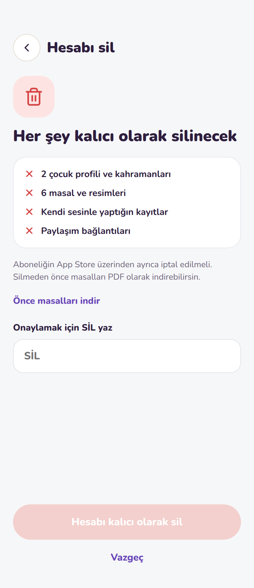

| | |
|---|---|
| Alan | Ebeveyn alanı |
| Rota | `deleteAccount` |
| Sunum | push |
| Boyut | 390 × 900 pt (prototip artboard) |
| Kaynak | `reference/html/HesapSil.dc.html` |

**Amaç.** Hesabı sil: silinecekler, 'SİL' yazarak onay.

**Veri.** DELETE account.

**Uygulama notları.** App Store 5.1.1(v) gereği uygulama içinden silme. Buton yalnızca SİL yazılınca aktif.

**Gezinme (dokununca nereye gider).**
- "Geri" → 32 · Ebeveyn · Ayarlar (tam sayfa)
- "Önce masalları indir" → 35 · Masal kitabı
- "Vazgeç" → 32 · Ebeveyn · Ayarlar (tam sayfa)

**Alanlar.** Onay (placeholder: "SİL")

**Durum görüntüleri.** [SİL yazıldı, buton aktif](../screens/state-HesapSil-aktif.png)

<details><summary>Ekrandaki metinler</summary>

```text
Hesabı sil
Her şey kalıcı olarak silinecek
2 çocuk profili ve kahramanları
6 masal ve resimleri
Kendi sesinle yaptığın kayıtlar
Paylaşım bağlantıları
Aboneliğin App Store üzerinden ayrıca iptal edilmeli. Silmeden önce masalları PDF olarak indirebilirsin.
Önce masalları indir
Onaylamak için SİL yaz
Hesabı kalıcı olarak sil
Vazgeç
```
</details>

---

## 40 · Widget'lar
<a id="40-widgetlar"></a>

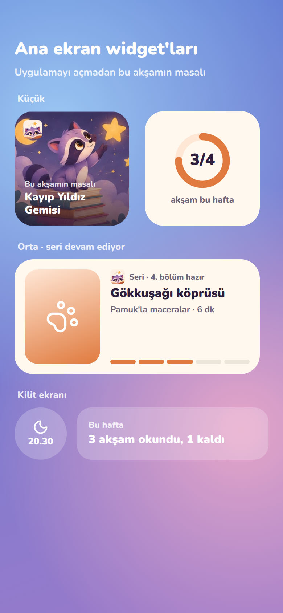

| | |
|---|---|
| Alan | iOS yüzeyleri |
| Rota | `yok` |
| Sunum | WidgetKit |
| Boyut | 390 × 844 pt (prototip artboard) |
| Kaynak | `reference/html/Widgetlar.dc.html` |

**Amaç.** Widget'lar: küçük (bu akşamın masalı, gece sahnesi), küçük halka (haftalık hedef), orta (seri), kilit ekranı.

**Veri.** App Group paylaşımlı veri.

**Uygulama notları.** Widget extension; deep link ile Okuyucu/Seri açılır.

**Gezinme (dokununca nereye gider).**
- "Bu akşamın masalı Kayıp Yıldız Gemisi" → 22 · Okuyucu · görselli
- "Seri · 4. bölüm hazır Gökkuşağı köprüsü Pamuk'la maceralar · 6 dk" → 18 · Seri masal

<details><summary>Ekrandaki metinler</summary>

```text
Ana ekran widget'ları
Uygulamayı açmadan bu akşamın masalı
Küçük
Bu akşamın masalı
Kayıp Yıldız Gemisi
3/4
akşam bu hafta
Orta · seri devam ediyor
Seri · 4. bölüm hazır
Gökkuşağı köprüsü
Pamuk'la maceralar · 6 dk
Kilit ekranı
20.30
Bu hafta
3 akşam okundu, 1 kaldı
```
</details>

---

## 41 · Kilit ekranı ve Siri
<a id="41-kilitekrani"></a>

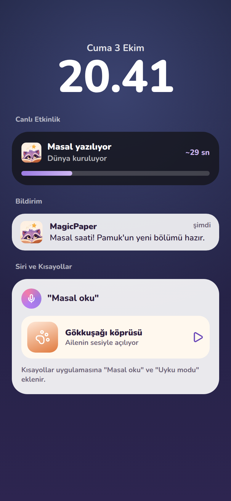

| | |
|---|---|
| Alan | iOS yüzeyleri |
| Rota | `yok` |
| Sunum | ActivityKit + App Intents |
| Boyut | 390 × 844 pt (prototip artboard) |
| Kaynak | `reference/html/KilitEkrani.dc.html` |

**Amaç.** Kilit ekranı: Live Activity (masal yazılıyor), bildirim, Siri 'Masal oku'.

**Veri.** Job progress push.

**Uygulama notları.** Live Activity iş durumlarıyla güncellenir.

**Gezinme (dokununca nereye gider).**
- "MagicPaper şimdi Masal saati! Pamuk'un yeni bölümü hazır." → 22 · Okuyucu · görselli
- "Gökkuşağı köprüsü Ailenin sesiyle açılıyor" → 22 · Okuyucu · görselli

<details><summary>Ekrandaki metinler</summary>

```text
Cuma 3 Ekim
20.41
Canlı Etkinlik
Masal yazılıyor
Dünya kuruluyor
~28 sn
Bildirim
MagicPaper
şimdi
Masal saati! Pamuk'un yeni bölümü hazır.
Siri ve Kısayollar
"Masal oku"
Gökkuşağı köprüsü
Ailenin sesiyle açılıyor
Kısayollar uygulamasına "Masal oku" ve "Uyku modu" eklenir.
```
</details>

---

## 42 · Boş kitaplık
<a id="42-boskitaplik"></a>

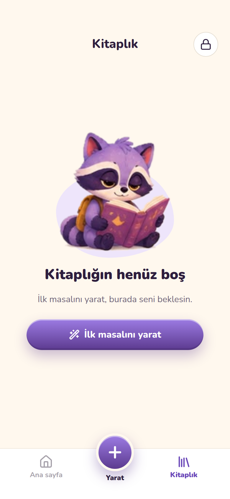

| | |
|---|---|
| Alan | Durum ekranları |
| Rota | `kid(.library) [empty]` |
| Sunum | state |
| Boyut | 390 × 844 pt (prototip artboard) |
| Kaynak | `reference/html/BosKitaplik.dc.html` |

**Amaç.** Boş kitaplık: okuyan rakun, İlk masalını yarat.

**Veri.** yok

**Uygulama notları.** Kitaplık listesi boşken.

**Gezinme (dokununca nereye gider).**
- "Ebeveyn bölümü" → 28 · Ebeveyn kapısı
- "İlk masalını yarat" → 19 · Yarat 1 · Dünya (tam sayfa)
- "Ana sayfa" → 11 · Ana sayfa (tam sayfa)
- "Yarat" → 19 · Yarat 1 · Dünya (tam sayfa)
- "Kitaplık" → 16 · Kitaplık (tam sayfa)

<details><summary>Ekrandaki metinler</summary>

```text
Kitaplık
Kitaplığın henüz boş
İlk masalını yarat, burada seni beklesin.
İlk masalını yarat
Ana sayfa
Yarat
```
</details>

---

## 43 · Üretim başarısız
<a id="43-uretimhata"></a>

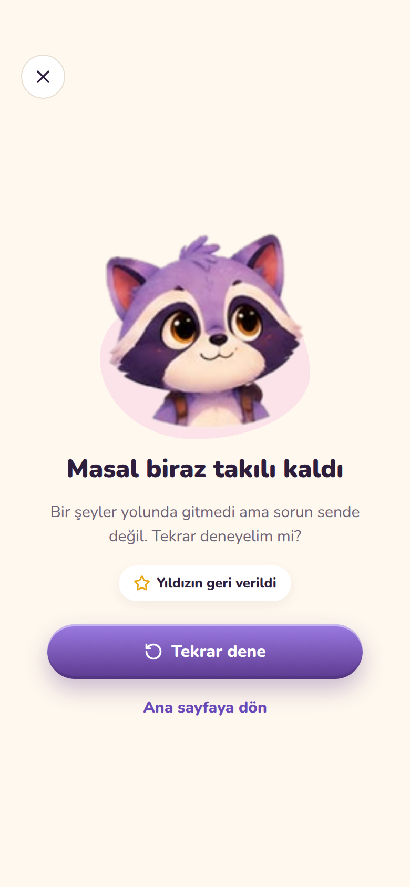

| | |
|---|---|
| Alan | Durum ekranları |
| Rota | `generating(jobId) [failed]` |
| Sunum | state |
| Boyut | 390 × 844 pt (prototip artboard) |
| Kaynak | `reference/html/UretimHata.dc.html` |

**Amaç.** Masal takıldı: şaşkın rakun, yıldız iade bilgisi, Tekrar dene.

**Veri.** generation_failed.

**Uygulama notları.** Suçlamayan dil.

**Gezinme (dokununca nereye gider).**
- "Kapat" → 11 · Ana sayfa (tam sayfa)
- "Tekrar dene" → 21 · Masal yazılıyor
- "Ana sayfaya dön" → 11 · Ana sayfa (tam sayfa)

<details><summary>Ekrandaki metinler</summary>

```text
Masal biraz takılı kaldı
Bir şeyler yolunda gitmedi ama sorun sende değil. Tekrar deneyelim mi?
Yıldızın geri verildi
Tekrar dene
Ana sayfaya dön
```
</details>

---

## 44 · İnternet yok
<a id="44-internetyok"></a>

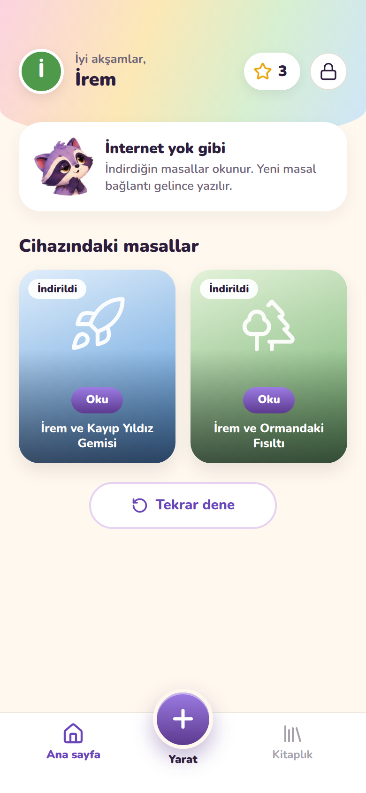

| | |
|---|---|
| Alan | Durum ekranları |
| Rota | `kid(.home) [offline]` |
| Sunum | state |
| Boyut | 390 × 844 pt (prototip artboard) |
| Kaynak | `reference/html/InternetYok.dc.html` |

**Amaç.** İnternet yok: düşünceli rakun banner, cihazdaki masallar.

**Veri.** NWPathMonitor, yerel masallar.

**Uygulama notları.** Yeni masal bağlantı gelince yazılır.

**Gezinme (dokununca nereye gider).**
- "İ İyi akşamlar, İrem" → 12 · Benim köşem (tam sayfa)
- "3" → 12 · Benim köşem (tam sayfa)
- "Ebeveyn bölümü" → 28 · Ebeveyn kapısı
- "İndirildi Oku İrem ve Kayıp Yıldız Gemisi" → 23 · Okuyucu · sadece metin
- "İndirildi Oku İrem ve Ormandaki Fısıltı" → 23 · Okuyucu · sadece metin
- "Ana sayfa" → 11 · Ana sayfa (tam sayfa)
- "Yarat" → 19 · Yarat 1 · Dünya (tam sayfa)
- "Kitaplık" → 16 · Kitaplık (tam sayfa)

**Ekran içi kontroller.** `Tekrar dene`

<details><summary>Ekrandaki metinler</summary>

```text
İyi akşamlar,
İrem
İnternet yok gibi
İndirdiğin masallar okunur. Yeni masal bağlantı gelince yazılır.
Cihazındaki masallar
İndirildi
Oku
İrem ve Kayıp Yıldız Gemisi
İrem ve Ormandaki Fısıltı
Tekrar dene
Ana sayfa
Yarat
Kitaplık
```
</details>

---

## 45 · Yıldız bitti
<a id="45-yildizbitti"></a>

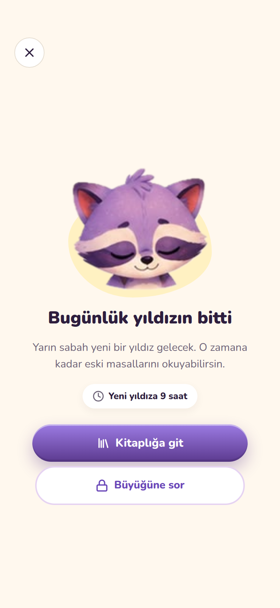

| | |
|---|---|
| Alan | Durum ekranları |
| Rota | `create [no_stars]` |
| Sunum | state |
| Boyut | 390 × 844 pt (prototip artboard) |
| Kaynak | `reference/html/YildizBitti.dc.html` |

**Amaç.** Yıldız bitti: uykulu rakun, yeni yıldıza kalan süre, Kitaplığa git / Büyüğüne sor.

**Veri.** no_stars (402).

**Uygulama notları.** Çocuğa satın alma gösterilmez.

**Gezinme (dokununca nereye gider).**
- "Kapat" → 20 · Yarat 2 · Ayarla (tam sayfa)
- "Kitaplığa git" → 16 · Kitaplık (tam sayfa)
- "Büyüğüne sor" → 28 · Ebeveyn kapısı

<details><summary>Ekrandaki metinler</summary>

```text
Bugünlük yıldızın bitti
Yarın sabah yeni bir yıldız gelecek. O zamana kadar eski masallarını okuyabilirsin.
Yeni yıldıza 9 saat
Kitaplığa git
Büyüğüne sor
```
</details>
