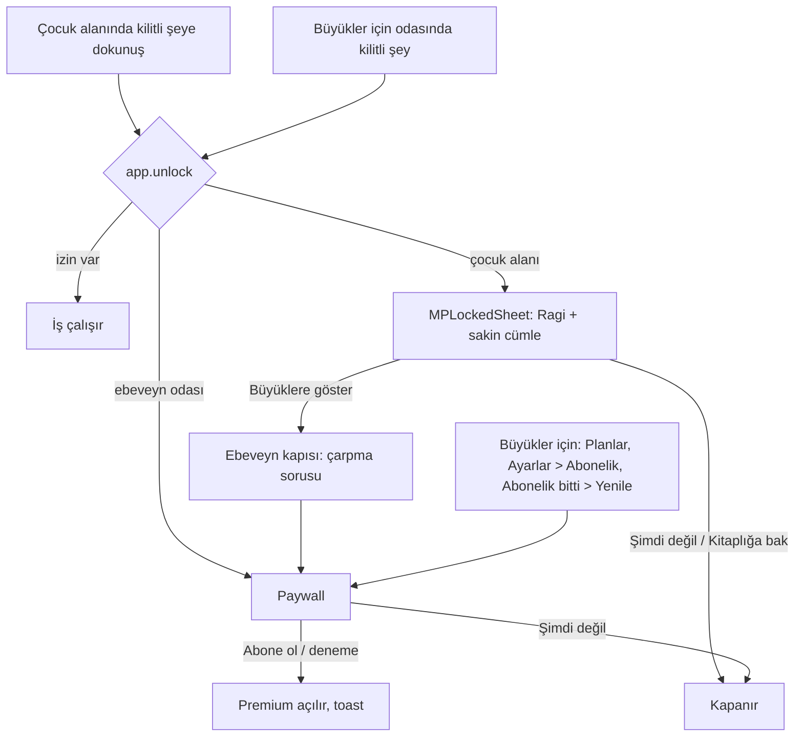

# Paywall nerede çıkar

Hazırlayan: İrem (Claude ile), 21 Kasım 2026. Dal: `irem`. Kaynak: koddaki kilit noktaları (`MPAppState.unlock`, `MPLockedSheet`, `EntitlementPolicy`), Batuhan'ın 20 Kasım abonelik kararı, `docs/PAYWALL_EKONOMI_PLANI.md`.

**Kural tek cümlede:** çocuk fiyat görmez. Çocuk alanında kapalı bir şeye dokunulunca sakin bir kilit penceresi açılır; satış yalnızca ebeveyn kapısının arkasında, Paywall'da yapılır. Ebeveyn odasında kilitli bir şeye dokunulunca Paywall doğrudan açılır.

## Akış

## Paywall'a giden yollar

| # | Nerede | Ne zaman kilitlenir | Çocuğun gördüğü | Kod |
|---|---|---|---|---|
| 1 | Masal yaz (alt çubuk daire, ana sayfa daveti ve dünya karoları, Bana sürpriz yap) | Günün ücretsiz masalı yazıldıktan sonra ikinci yeni masal | "Bugünün masalı yazıldı" · birincil **Kitaplığa bak**, ikincil "Büyükler için" | `MPAppState.startStoryCreation` → `.unlimitedTextStories` |
| 2 | Masal ailem'e ikinci kişi ekleme; masal yazarken ikinci kişiyi seçme | Ücretsiz pay 1 kişi | "Masal ailem" · Büyüklere göster | `FamilyCharactersView`, `startStoryCreation` → `.familyCast` |
| 3 | İkinci çocuk profili (Profil "Ekle", Ayarlar "Profil ekle") | Ücretsiz pay 1 çocuk | "Yeni bir çocuk" · Büyüklere göster | `KidCornerView`, `SettingsView` → `.multipleChildren` |
| 4 | Vitrin dışı klasik ya da Original (Masallar, Kitaplık, ana sayfa önerisi) | Klasik vitrini ücretsiz, gerisi Premium | "Büyüklerle açılan bir masal" | `MPAppState.readClassic` / `readOriginal` → `.classicLibrary` |
| 5 | **Seri kartı, günü gelmiş kilitli bölüm (yeni, 21 Kasım)** | İlk yeni bölüm ücretsiz, sonrakiler Premium | Kart "3. bölüm büyüklerle açılır" → "Masalın devamı" · Büyüklere göster | `SeriesManager.cardState` → `.locked`, `SeriesCard` → `.seriesStories` |
| 6 | PDF masal kitabı (Büyükler için "Kitap yap", çocuk profili) | Premium | Ebeveyn odası: Paywall doğrudan | `ParentOverviewView`, `ProfileHubView` → `.pdfBook` |
| 7 | Büyükler için: abonelik satırı "Planlar", Ayarlar > Abonelik | Her zaman | Ebeveyn odası | `ParentOverviewView`, `SettingsView` → `openPaywall()` |
| 8 | Abonelik bitti ekranı > Yenile | Abonelik sona erince bir kez | Ebeveyn odası | `SubscriptionExpiredView` → `openPaywall()` |

Kendi sesin (`.ownVoice`) Release'te kapalı (`FamilyFeatureAccess`); açılınca 6 gibi çalışır.

## Paywall asla çıkmaz

- Masal sonunda ve okuyucunun içinde (AGENTS.md: masal sonunda dükkân yok). Seri teklifi kilitliyse masal sonunda görünmez.
- Bildirimde, widget'ta, Live Activity'de. Widget kilitli seri bölümü için açılış günü vaat etmez.
- Çocuk ekranında fiyat, sayı ya da geri sayım olarak.
- İlk açılışta, ilk masaldan önce.

## Bu turda düzeltilenler (21 Kasım)

1. **Seri kartı sonsuza kadar "yarın" diyordu.** Ücretsiz kullanıcıda Premium bölümün günü geldiğinde de kart "3. bölüm yarın" yazıyordu; bölüm hiç açılmıyordu. Artık kart günü gelince "büyüklerle açılır" der ve kilit penceresine gider. Premium alınınca bölüm, kart bir sonraki açılışta kendiliğinden açılır.
2. **Deneme uygunluğu.** Daha önce deneme kullanmış hesaba "7 gün ücretsiz başla" yazılmıyor. `RevenueCatManager` ürünler yüklenince uygunluğu sorar (`checkTrialOrIntroDiscountEligibility`), uygun değilse düğme "Abone ol" olur, deneme takvimi gizlenir. Cevap "bilinmiyor" ise deneme gösterilir; gerçek fiyat Apple'ın ödeme penceresinde zaten yazar.

## Açık öneriler (Batuhan'ın kararı)

1. **Satın aldıktan sonra kaldığı işe dönmek.** Bugün ebeveyn Premium alınca Paywall kapanır, çocuk aynı şeye yeniden dokunmak zorunda (ör. seri bölümü, ikinci kişi). Öneri: `unlock` reddettiği işi saklasın, satın alma başarılıysa Paywall kapandıktan sonra çalıştırsın. Modal sırası (`closeSheet`) senin kurduğun yapıda; o yüzden kodlamadım.
2. **İlk deneyimden sonra ebeveyne tek bir tanıtım.** İlk masal okunup hatırlatma sorusu cevaplandıktan sonra (ebeveyn o an telefonu tutuyor) Büyükler için özetinde bir kez sakin bir "MagicPaper Premium" kartı. Masal sonunda değil, çocuk ekranında değil. Apple'ın da önerdiği "önce deneyim, sonra teklif" sırası.
3. **Günlük limit penceresinin metni.** "Büyükler için" düğmesi yerine "Büyüklere göster" (diğer kilitlerle aynı söz).
